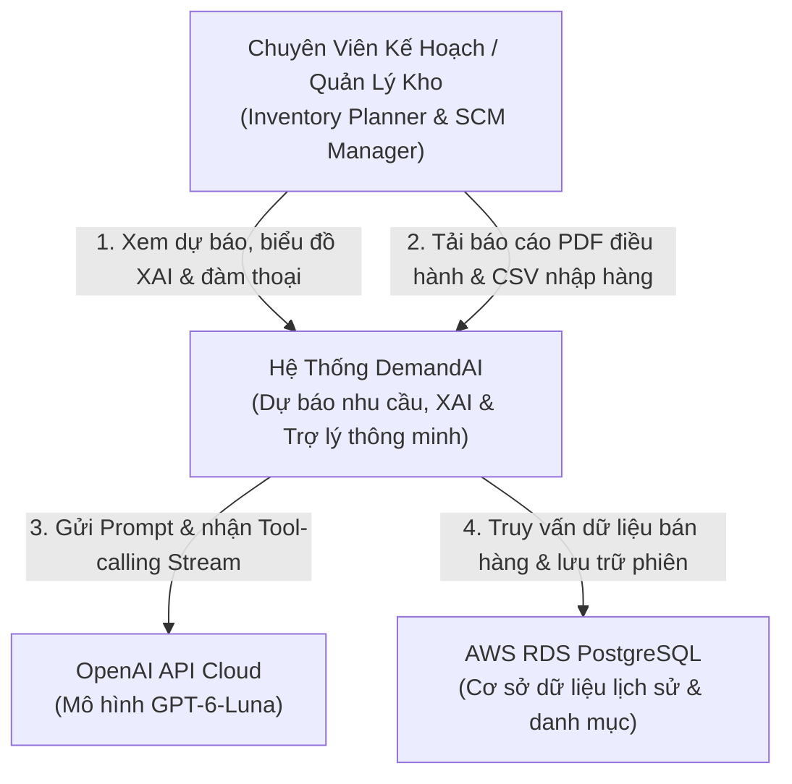
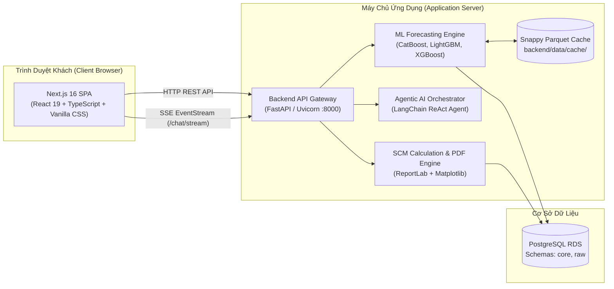
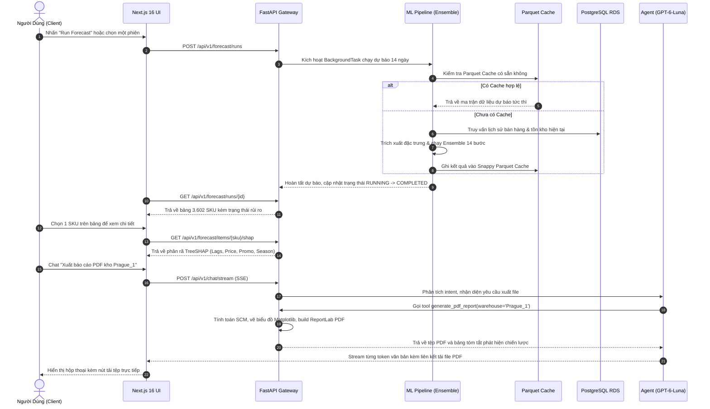

# 🏛️ 00. Tổng Quan Hệ Thống & Mô Hình Vận Hành (System Overview & Mental Model)

> **Mục tiêu**: Cung cấp bức tranh phân tích kiến trúc tổng thể của nền tảng DemandAI theo mô hình C4, phân tích luồng dữ liệu toàn trình (End-to-End Lifecycle) và lý giải chuyên sâu các quyết định thiết kế cốt lõi (Architectural Trade-offs).  
> **Thư mục liên quan**: [backend/app/](../../backend/app/), [frontend/src/](../../frontend/src/)

---

## 1. Bài Toán Nghiệp Vụ & Mô Hình Tư Duy (Mental Model)

### 1.1. Thách thức trong Quản trị Chuỗi Cung Ứng Bán Lẻ
Trong ngành bán lẻ và chuỗi cung ứng hiện đại, người vận hành luôn phải đối mặt với hai thái cực rủi ro đối nghịch:
1. **Rủi ro thiếu hàng (Stockout Risk)**: Xảy ra khi nhu cầu đột biến hoặc chu kỳ đặt hàng bị trễ. Hậu quả là mất doanh thu ngay lập tức, suy giảm uy tín thương hiệu và mất thị phần vào tay đối thủ.
2. **Rủi ro tồn ứ đọng vốn (Deadstock / Excess Inventory Risk)**: Xảy ra khi đặt hàng quá mức do dự báo thiếu chính xác. Hậu quả là chôn vùi vốn lưu động, phát sinh chi phí kho bãi, bảo quản, khấu hao và nguy cơ hết hạn sử dụng.

### 1.2. Mô hình 4 Trụ Cột của DemandAI
DemandAI giải quyết mâu thuẫn trên thông qua hệ thống kết hợp 4 thành phần:
* **Dự báo đệ quy đa mô hình (Recursive Ensemble Forecasting)**: Dự báo chính xác sản lượng bán lẻ cho từng SKU trong chu kỳ 14 ngày tới.
* **Minh bạch hóa quyết định (Explainable AI - TreeSHAP)**: Bóc tách nguyên nhân đằng sau dự báo (do giá, khuyến mãi, tính mùa vụ hay quán tính bán hàng).
* **Trợ lý Agentic AI (ReAct Agent với GPT-6-Luna)**: Giúp người dùng tra cứu, phân tích kịch bản và nhận khuyến nghị qua ngôn ngữ tự nhiên.
* **Cơ chế báo cáo quản trị tức thì (Automated SCM Reporting)**: Tự động hóa việc sinh tài liệu PDF điều hành và tệp CSV phục vụ đặt hàng ngay lập tức.

---

## 2. Phân Tích Kiến Trúc Theo Mô Hình C4 (C4 Model)

### 2.1. C4 Level 1: System Context (Bối cảnh Hệ thống)

### 2.2. C4 Level 2: Container Diagram (Các Khối Vận Hành)

### 2.3. C4 Level 3: Component Diagram (Các Thành Phần Phía Backend)

Phía Backend được cấu trúc theo mô hình phân lớp rõ ràng:
1. **API Routing Layer** ([backend/app/api/](../../backend/app/api/)):
   - `routes/forecast.py`: Quản lý phiên dự báo, truy vấn dữ liệu theo SKU/kho, trả về SHAP values.
   - `routes/chat.py`: Điểm tiếp nhận luồng hội thoại SSE, khởi tạo session agent và điều phối tool call.
   - `routes/health.py`: Kiểm tra trạng thái máy chủ và kết nối cơ sở dữ liệu.
2. **Predictive & Machine Learning Layer** ([backend/app/pipeline/](../../backend/app/pipeline/)):
   - `recursive_ensemble.py`: Động cơ dự báo lặp 14 bước kết hợp 3 thuật toán gradient boosting.
   - `feature_engineering.py`: Xử lý đặc trưng tự động (lags, rolling stats, price ratio, calendar indicators).
   - `item_shap.py`: Phân rã giá trị Shapley theo 4 nhóm động lực.
3. **Agent & Intelligence Layer** ([backend/app/agent/](../../backend/app/agent/)):
   - `sku_agent.py`: Khởi tạo ReAct Agent, quản lý bộ nhớ đệm hội thoại, tích hợp mô hình GPT-6-Luna.
   - `tools.py`: Tập hợp 10 công cụ nghiệp vụ có khả năng truy vấn DB, chạy mô phỏng, xuất file.
   - `fallback.py`: Động cơ dự phòng độc lập, xử lý các câu hỏi nghiệp vụ khi hệ thống mất kết nối mạng.
4. **Supply Chain & Reporting Layer** ([backend/app/services/](../../backend/app/services/)):
   - `report_data_service.py`: Tính toán Dynamic ROP, Safety Stock, Days of Supply, phân loại rủi ro.
   - `pdf_report_generator.py`: Dàn trang tài liệu PDF 2 trang ngang bằng ReportLab với biểu đồ tích hợp.
   - `forecast_artifacts.py`: Quản trị tệp xuất khẩu và tự động dọn dẹp (auto-prune).

---

## 3. Vòng Đời Dữ Liệu Toàn Trình (End-to-End Data Lifecycle)

Vòng đời của một phiên xử lý dữ liệu trong hệ thống diễn ra qua 5 giai đoạn liên tục:

---

## 4. Phân Tích Các Quyết Định Thiết Kế & Đánh Đổi (Architectural Trade-offs)

Trong quá trình xây dựng DemandAI, các quyết định kiến trúc đã được cân nhắc kỹ lưỡng giữa các phương án kỹ thuật:

### 4.1. Server-Sent Events (SSE) vs. WebSockets vs. HTTP Polling cho Chat Agent
* **Lựa chọn**: **Server-Sent Events (SSE)** thông qua thư viện `httpx-sse` và `fetchEventSource`.
* **Lý do lựa chọn**:
  * Luồng trao đổi của LLM mang tính **đơn hướng thời gian thực**: Người dùng gửi một câu hỏi ngắn (1 HTTP POST), sau đó máy chủ liên tục đẩy dòng suy nghĩ và từng token từ GPT-6-Luna về client.
  * SSE chạy trên giao thức HTTP tiêu chuẩn, đi qua tường lửa (firewall), proxy và load balancer mà không đòi hỏi nâng cấp giao thức phức tạp như WebSockets.
  * Tự động hỗ trợ cơ chế kết nối lại (*auto-reconnect*) và mã định danh sự kiện (*event ID*).
* **Đánh đổi**: SSE không hỗ trợ truyền nhị phân 2 chiều đồng thời, nhưng điều này hoàn toàn không cần thiết đối với bài toán đàm thoại tương tác văn bản và tool-calling.

### 4.2. Snappy Parquet File Cache vs. Pure RDS Queries vs. Redis In-Memory
* **Lựa chọn**: **Snappy-compressed Parquet File Cache** tại `backend/data/cache/`.
* **Lý do lựa chọn**:
  * Tập dữ liệu gồm 3.602 SKU $\times$ 14 ngày dự báo $\approx$ 50.428 bản ghi chi tiết kèm theo hàng chục cột đặc trưng (lags, rolling averages, predictions).
  * Truy vấn bảng quan hệ trên PostgreSQL cho từng thao tác lọc/sắp xếp của giao diện sẽ gây tải lớn lên RDS và có độ trễ I/O từ 300ms đến 1.200ms.
  * Parquet lưu trữ theo định dạng cột (columnar storage), nén bằng Snappy giúp giảm dung lượng tệp từ ~85MB xuống còn ~4.2MB, cho phép nạp trực tiếp vào bộ nhớ RAM bằng PyArrow / Polars / Pandas chỉ trong **dưới 15ms**.
* **Đánh đổi**: Cần cơ chế kiểm tra tính hợp lệ của cache (invalidation strategy) khi người dùng kích hoạt phiên dự báo mới. Hệ thống giải quyết bằng cách đặt tên cache gắn liền với mã băm dữ liệu và timestamp của phiên chạy.

### 4.3. Kiến Trúc Dự Phòng Kép: Cloud LLM (GPT-6-Luna) vs. Deterministic Local Fallback
* **Lựa chọn**: **Double-tier Architecture** tích hợp sẵn `fallback.py` độc lập.
* **Lý do lựa chọn**:
  * Trong môi trường sản xuất thực tế, kết nối đến OpenAI API có thể bị gián đoạn do sự cố mạng, chạm ngưỡng giới hạn tốc độ (rate limit), hoặc khi triển khai tại các kho hàng nội bộ không có kết nối internet quốc tế ổn định.
  * Nếu phụ thuộc hoàn toàn vào Cloud LLM, người vận hành sẽ không thể tra cứu tồn kho khẩn cấp hoặc xuất báo cáo nhập hàng.
  * Bộ máy `fallback.py` hoạt động dựa trên các luật nghiệp vụ tất định (deterministic pattern matching và SQL direct query), đảm bảo trả lời chính xác 100% về mặt số liệu cho các câu hỏi tra cứu, tính toán ROP và xuất báo cáo PDF ngay cả khi ngắt kết nối mạng hoàn toàn.
* **Đánh đổi**: Ngôn ngữ phản hồi của chế độ Fallback mang tính khuôn mẫu hơn so với độ mượt mà tự nhiên của GPT-6-Luna, nhưng tính sẵn sàng của hệ thống đạt mức 99.99%.

### 4.4. Client-side Rendering (CSR) với Canvas Tương Tác vs. Pure SSR
* **Lựa chọn**: **Next.js 16 Client-side Interactive Canvas** với React 19.
* **Lý do lựa chọn**:
  * Bảng dữ liệu chính hiển thị hàng ngàn SKU với các thao tác người dùng liên tục: lọc theo kho, lọc theo rủi ro, tìm kiếm tức thì theo tên, chuyển trang, và kích hoạt vẽ biểu đồ SHAP.
  * Việc kết xuất tại client giúp giao diện phản hồi mượt mà ở tốc độ 60fps mà không cần tải lại trang hay gây áp lực liên tục lên máy chủ backend.
* **Đánh đổi**: Dung lượng gói JavaScript ban đầu lớn hơn một chút so với SSR thuần túy, nhưng được bù đắp hoàn toàn bởi trải nghiệm mượt mà của người dùng.

---

## 5. Tóm Tắt & Định Hướng Đọc Tiếp

Mô hình kiến trúc DemandAI được tối ưu cho **tốc độ phản hồi cao**, **tính minh bạch của thuật toán** và **độ tin cậy trong môi trường doanh nghiệp**. 

Để đi sâu vào chi tiết kỹ thuật của từng thành phần, vui lòng tiếp tục với:
* [01_data_and_ml_pipeline_analysis.md](./01_data_and_ml_pipeline_analysis.md): Phân tích chi tiết mô hình ML Ensemble và thuật toán TreeSHAP.
* [02_agentic_ai_and_llm_orchestration.md](./02_agentic_ai_and_llm_orchestration.md): Phân tích kiến trúc ReAct Agent và 10 công cụ nghiệp vụ.
