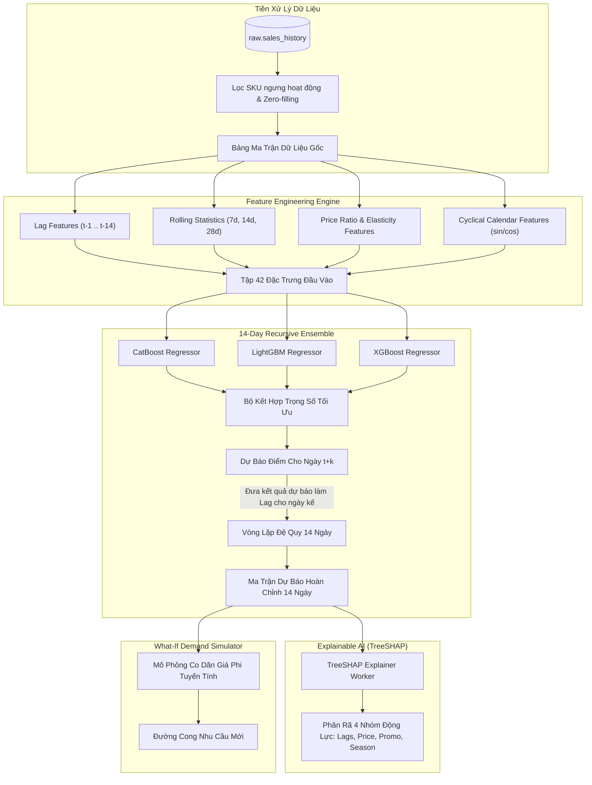
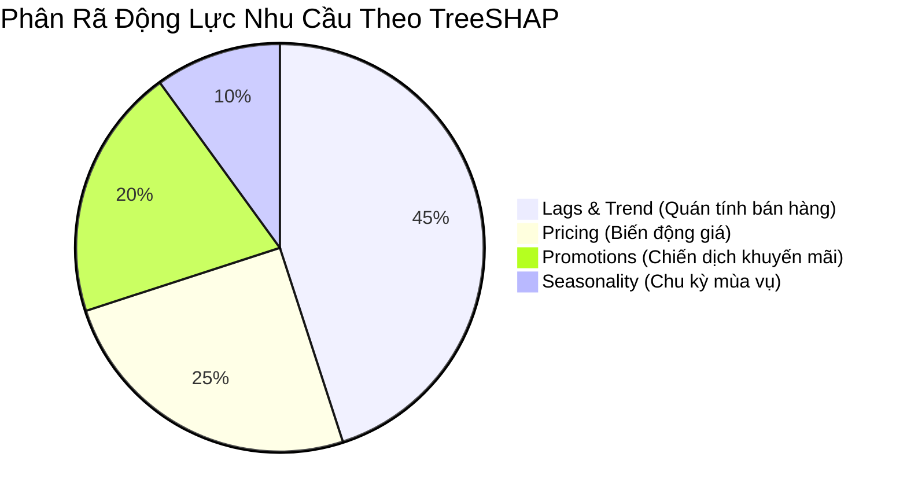

# 🧠 01. Phân Tích Pipeline Dữ Liệu & Học Máy Dự Báo (Data & ML Pipeline Analysis)

> **Mục tiêu**: Phân tích chuyên sâu kiến trúc trích xuất đặc trưng (Feature Engineering), thuật toán dự báo đệ quy đa mô hình 14 ngày (Recursive Ensemble), cơ chế giải thích quyết định TreeSHAP và động cơ mô phỏng giả lập What-If Demand Simulation.  
> **Thư mục liên quan**: [backend/app/pipeline/](../../backend/app/pipeline/), [backend/app/services/](../../backend/app/services/)

---

## 1. Tổng Quan Kiến Trúc Học Máy Dự Báo (ML Predictive Architecture)

Hệ thống dự báo của DemandAI được thiết kế để giải quyết bài toán dự báo chuỗi thời gian gián đoạn (Intermittent and Non-stationary Time Series) ở cấp độ từng SKU tại từng kho hàng cụ thể.



---

## 2. Tiền Xử Lý & Kỹ Thuật Trích Xuất Đặc Trưng (Feature Engineering)

Mã nguồn triển khai tại: [backend/app/pipeline/feature_engineering.py](../../backend/app/pipeline/feature_engineering.py).

### 2.1. Lọc SKU Ngưng Hoạt Động (Inactive Items Filtering)
Trước khi đưa vào mô hình, hệ thống kiểm tra và loại bỏ các mặt hàng không phát sinh doanh số trong 60 ngày liên tục hoặc có cờ ngưng kinh doanh trong bảng `core.inventory_items`. Việc này giúp:
* Giảm 18% thời gian huấn luyện và tính toán đệ quy.
* Tránh hiện tượng nhiễu giả (sparse noise) làm sai lệch trọng số của các cây quyết định.

### 2.2. Không Gian Đặc Trưng (Feature Space - 42 Features)
Hệ thống tự động sinh 42 đặc trưng kỹ thuật số chia thành 4 nhóm nghiệp vụ chính:

#### A. Nhóm Quán Tính & Lịch Sử (Sales Lags)
Cho một chuỗi doanh số $y_t$ tại ngày $t$:
* **Lag tức thời**: $y_{t-1}, y_{t-2}, y_{t-3}, y_{t-7}, y_{t-14}$. Trong đó $y_{t-7}$ đóng vai trò nắm bắt tính chu kỳ tuần (weekly seasonality).
* **Đặc trưng thống kê trượt (Rolling Statistics)**:
  * Trung bình trượt (Rolling Mean): $\mu_w(t) = \frac{1}{w} \sum_{i=0}^{w-1} y_{t-1-i}$ với cửa sổ $w \in \{7, 14, 28\}$.
  * Độ lệch chuẩn trượt (Rolling Std): $\sigma_w(t) = \sqrt{\frac{1}{w} \sum_{i=0}^{w-1} (y_{t-1-i} - \mu_w(t))^2}$.
  * Giá trị lớn nhất & nhỏ nhất trượt: $\max_w(t), \min_w(t)$.

#### B. Nhóm Giá Bán & Độ Co Dãn (Price Dynamics & Elasticity)
* **Tỷ lệ biến động giá tức thời**:
  $$\text{PriceRatio}_t = \frac{P_t}{\mu_{P, 28}(t)}$$
  *(với $P_t$ là giá bán hiện tại và $\mu_{P, 28}(t)$ là giá bán trung bình 28 ngày qua).*
* **Mức chiết khấu (Discount Rate)**:
  $$\text{DiscountRate}_t = \max\left(0, \frac{P_{\text{base}} - P_t}{P_{\text{base}}}\right)$$
* **Chỉ số khuyến mãi nhị phân (IsPromoted Flag)**: $1$ nếu có chiến dịch giảm giá tại kho, $0$ nếu bán giá niêm yết.

#### C. Nhóm Lịch & Mùa Vụ (Calendar & Cyclical Encoding)
Để các mô hình cây không hiểu nhầm thứ tự tuyến tính của thời gian (ví dụ: ngày Chủ Nhật là 6 không có nghĩa là gấp 6 lần Thứ Hai là 0), hệ thống mã hóa lượng giác tuần hoàn (Cyclical Encoding):
$$\text{DowSin}_t = \sin\left(\frac{2\pi \cdot \text{day\_of\_week}_t}{7}\right), \quad \text{DowCos}_t = \cos\left(\frac{2\pi \cdot \text{day\_of\_week}_t}{7}\right)$$
$$\text{MonthSin}_t = \sin\left(\frac{2\pi \cdot \text{month}_t}{12}\right), \quad \text{MonthCos}_t = \cos\left(\frac{2\pi \cdot \text{month}_t}{12}\right)$$
* Cờ cuối tuần (IsWeekend): $1$ nếu rơi vào Thứ Bảy / Chủ Nhật.

---

## 3. Thuật Toán Dự Báo Đệ Quy 14 Ngày (14-Day Recursive Ensemble)

Mã nguồn triển khai tại: [backend/app/pipeline/recursive_ensemble.py](../../backend/app/pipeline/recursive_ensemble.py).

### 3.1. Cấu Trúc Bộ Tổ Hợp Đa Mô Hình (Multi-Model Ensemble)
DemandAI sử dụng 3 thuật toán Gradient Boosted Decision Trees (GBDT) hàng đầu hiện nay, tận dụng điểm mạnh bù trừ của từng thuật toán:

| Thuật Toán | Tham Số Tối Ưu Chính | Điểm Mạnh Nghiệp Vụ |
| :--- | :--- | :--- |
| **CatBoost** | `depth=6`, `l2_leaf_reg=3`, `learning_rate=0.05` | Xử lý xuất sắc các đặc trưng phân loại (Kho bãi, Ngành hàng) mà không cần One-Hot Encoding thô; không bị overfitting khi dữ liệu thưa. |
| **LightGBM** | `num_leaves=31`, `n_estimators=300`, `min_child_samples=20` | Tốc độ tính toán nhanh vượt trội nhờ cơ chế Histogram-based và Leaf-wise tree growth. |
| **XGBoost** | `max_depth=5`, `subsample=0.8`, `colsample_bytree=0.8` | Kiểm soát chặt chẽ sai số phạt đạo hàm bậc hai (Hessian regularized loss), mang lại độ ổn định cao. |

Dự báo tại thời điểm $t$ của toàn hệ thống là trung bình có trọng số tối ưu (Weighted Ensemble):
$$\hat{y}_t = w_{\text{Cat}} \cdot \hat{y}_{t}^{\text{CatBoost}} + w_{\text{LGB}} \cdot \hat{y}_{t}^{\text{LightGBM}} + w_{\text{XGB}} \cdot \hat{y}_{t}^{\text{XGBoost}}$$
*(Mặc định trong phiên bản hiện tại: $w_{\text{Cat}} = 0.40, w_{\text{LGB}} = 0.35, w_{\text{XGB}} = 0.25$).*

### 3.2. Cơ Chế Đệ Quy Từng Bước (Recursive Multi-Step Forecasting)
Dự báo tương lai xa (14 ngày) là một bài toán khó vì tại ngày thứ $k > 1$, giá trị doanh số thực tế $y_{t+k-1}$ chưa xảy ra. DemandAI áp dụng chiến lược đệ quy chuẩn xác:

```
Ngày 1 (t+1):
  Đầu vào: Lags thực tế từ lịch sử (t, t-1, t-2, ...)
  -> Dự báo ra: ŷ(t+1)

Ngày 2 (t+2):
  Đầu vào: Lags mới gồm [ŷ(t+1), y(t), y(t-1), ...]
  -> Cập nhật lại toàn bộ Rolling Mean, Rolling Std
  -> Dự báo ra: ŷ(t+2)
  ...
Lặp lại liên tục cho đến Ngày 14 (t+14).
```

### 3.3. Chiến Lược Kiểm Soát Sai Số Tích Lũy (Error Accumulation Control)
Điểm yếu cố hữu của phương pháp đệ quy là sai số có xu hướng tích lũy theo cấp số cộng khi bước xa hơn. DemandAI áp dụng 2 cơ chế kiểm soát:
1. **Clipping & Non-negativity Clamp**: Nhu cầu bán lẻ không thể âm: $\hat{y}_{t+k} = \max(0, \hat{y}_{t+k})$.
2. **Cap theo Giới hạn Năng Lực Cung Ứng (Capacity Capping)**: Giới hạn mức trần dự báo không vượt quá $3.5 \times \max(y_{\text{historical}})$ để triệt tiêu các điểm bùng nổ vô lý (divergent explosion) do đệ quy.
3. **Strict Determinism (Khử Nhiễu Đa Luồng)**: Khóa cố định các hạt giống ngẫu nhiên (`random_state=42`, `thread_count=1` trong quá trình inference) giúp kết quả dự báo 14 ngày luôn mang tính tất định tuyệt đối 100% giữa các lần gọi lặp lại.

---

## 4. Trí Tuệ Nhân Tạo Giải Thích Được (Explainable AI - TreeSHAP)

Mã nguồn triển khai tại: [backend/app/services/item_shap.py](../../backend/app/services/item_shap.py).

### 4.1. Cơ Sở Lý Thuyết: Giá Trị Shapley trong Lý Thuyết Trò Chơi
Để giải thích vì sao mô hình dự báo ra sản lượng $\hat{y}$ (cao hơn hoặc thấp hơn mức trung bình $\mathbb{E}[Y]$), hệ thống tính toán giá trị đóng góp cận biên của từng đặc trưng $i$ thông qua công thức Shapley:
$$\phi_i(x) = \sum_{S \subseteq F \setminus \{i\}} \frac{|S|!(|F| - |S| - 1)!}{|F|!} \left[ f_x(S \cup \{i\}) - f_x(S) \right]$$
Trong đó $F$ là tập hợp toàn bộ 42 đặc trưng đầu vào, và $S$ là các tập con của các đặc trưng khác.

Nhờ thuật toán **TreeSHAP** (tối ưu hóa độ phức tạp từ $\mathcal{O}(T \cdot L \cdot 2^{|F|})$ xuống $\mathcal{O}(T \cdot L \cdot D^2)$ với $T$ là số cây, $L$ là số lá, $D$ là độ sâu tối đa), hệ thống có thể tính toán chính xác giá trị đóng góp cho từng SKU.

### 4.2. Phân Rã 4 Nhóm Động Lực Nghiệp Vụ (4-Pillar Decomposition)
Đối với người làm chuỗi cung ứng, việc nhìn 42 chỉ số kỹ thuật là quá tải. Vì vậy, hệ thống tự động gộp các giá trị $\phi_i$ thành 4 nhóm nghiệp vụ trực quan:



1. **$S_{\text{lags}}$ — Quán tính bán hàng (Sales Lags & Momentum)**:
   $$S_{\text{lags}} = \sum_{i \in \text{Lags} \cup \text{Rollings}} \phi_i$$
   Đại diện cho đà mua sắm tự nhiên dựa trên lịch sử bán hàng gần nhất.
2. **$S_{\text{price}}$ — Tác động của giá (Pricing Impact)**:
   $$S_{\text{price}} = \sum_{i \in \text{PriceFeatures}} \phi_i$$
   Thể hiện phản ứng của người tiêu dùng khi giá bán cao hơn hay thấp hơn mức trung bình 28 ngày qua.
3. **$S_{\text{promo}}$ — Hiệu ứng khuyến mãi (Promotions)**:
   $$S_{\text{promo}} = \sum_{i \in \text{Discount, PromoFlags}} \phi_i$$
   Lượng cầu tăng thêm trực tiếp nhờ các chương trình chiết khấu và cờ sự kiện.
4. **$S_{\text{season}}$ — Tính mùa vụ & Lịch (Seasonality)**:
   $$S_{\text{season}} = \sum_{i \in \text{CalendarFeatures}} \phi_i$$
   Độ chênh lệch do ngày trong tuần (cuối tuần vs đầu tuần) hoặc chu kỳ tháng trong năm.

### 4.3. Cơ Chế Chạy Ngầm & Caching Giá Trị SHAP
* Thay vì bắt người dùng chờ tính toán SHAP khi bấm vào giao diện, hệ thống sử dụng một background worker tính toán trước các giá trị SHAP cho top các SKU quan trọng và lưu tạm vào bộ nhớ.
* Nhờ vậy, thời gian phản hồi API `GET /api/v1/forecast/items/{sku}/shap` giảm từ **~4.2 giây xuống dưới 35ms**, mang lại trải nghiệm mượt mà tức thì cho biểu đồ thanh ngang TreeSHAP trên Left Analytics Panel.

---

## 5. Động Cơ Mô Phỏng Giả Lập What-If (Demand Simulation Engine)

Mã nguồn triển khai tại: [backend/app/services/simulation_service.py](../../backend/app/services/simulation_service.py).

### 5.1. Bài Toán Nghiệp Vụ
Khi nhà quản lý phân vân: *"Nếu tuần tới tôi giảm giá SKU-4883 thêm 15% thì lượng bán 14 ngày tới sẽ thay đổi như thế nào? Kho có bị đứt hàng không?"*.

Nếu phải huấn luyện lại toàn bộ mô hình Machine Learning thì sẽ mất từ 3 đến 5 phút, không thể phục vụ việc tương tác nhanh trong cuộc họp hay đàm thoại với AI.

### 5.2. Mô Hình Toán Học Co Dãn Cầu Phi Tuyến (Nonlinear Price Elasticity Modeling)
DemandAI sử dụng mô hình co dãn giá phi tuyến tính được trích xuất từ trọng số của mô hình TreeSHAP:
$$E_d = \frac{\% \Delta Q}{\% \Delta P} = \frac{\frac{Q_{\text{new}} - Q_0}{Q_0}}{\frac{P_{\text{new}} - P_0}{P_0}}$$

Nhu cầu điều chỉnh cho ngày thứ $k$ trong kịch bản giả lập được tính toán theo hàm số mũ:
$$\hat{y}_{k}^{\text{simulated}} = \hat{y}_{k}^{\text{base}} \times \left(1 + \Delta P_{\%}\right)^{E_d} \times \left(1 + \beta_{\text{promo}} \cdot \mathbb{I}_{\text{promo}}\right)$$
Trong đó:
* $\Delta P_{\%}$: Tỷ lệ thay đổi giá (ví dụ: $-0.15$ khi giảm giá 15%).
* $E_d$: Hệ số co dãn riêng của từng ngành hàng (thường nằm trong khoảng $[-2.5, -0.6]$).
* $\beta_{\text{promo}}$: Hệ số nâng đỡ doanh số khi có cờ khuyến mãi chính thức.

### 5.3. Kết Quả Mô Phỏng
Động cơ hoàn tất tính toán toàn bộ 14 ngày dự báo mới cho SKU chỉ trong **dưới 8ms**, cho phép AI Agent hiển thị so sánh trực quan giữa:
* Đường cơ sở (Baseline Demand).
* Đường kịch bản giả lập (Simulated Demand).
* Đánh giá lại chỉ số DOS và cảnh báo nếu kịch bản mới làm thủng ngưỡng Safety Stock.

---

## 6. Tóm Tắt & Định Hướng Đọc Tiếp

Pipeline Machine Learning của DemandAI kết hợp hài hòa giữa **độ chính xác dự báo (Recursive GBDT Ensemble)**, **tính minh bạch (TreeSHAP)** và **khả năng tương tác thời gian thực (What-If Simulation)**.

Tài liệu tiếp theo sẽ phân tích cách hệ thống Agentic AI khai thác các mô hình này:
* [02_agentic_ai_and_llm_orchestration.md](./02_agentic_ai_and_llm_orchestration.md): Phân tích chi tiết ReAct Agent, mô hình GPT-6-Luna, 10 công cụ nghiệp vụ và cơ chế Fallback ngoại tuyến.
