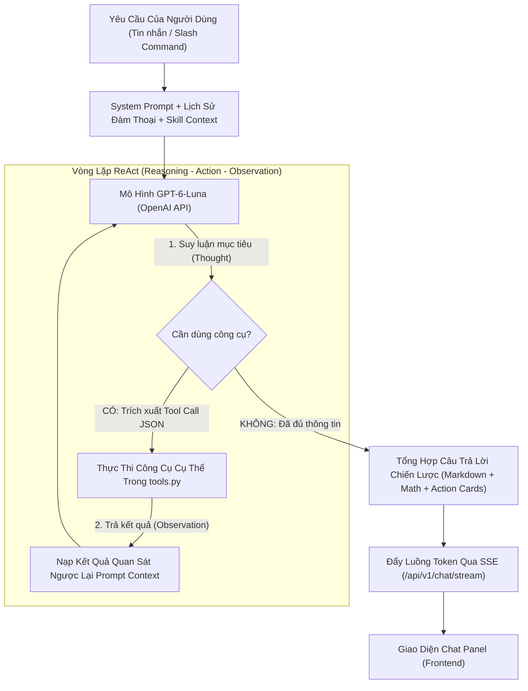
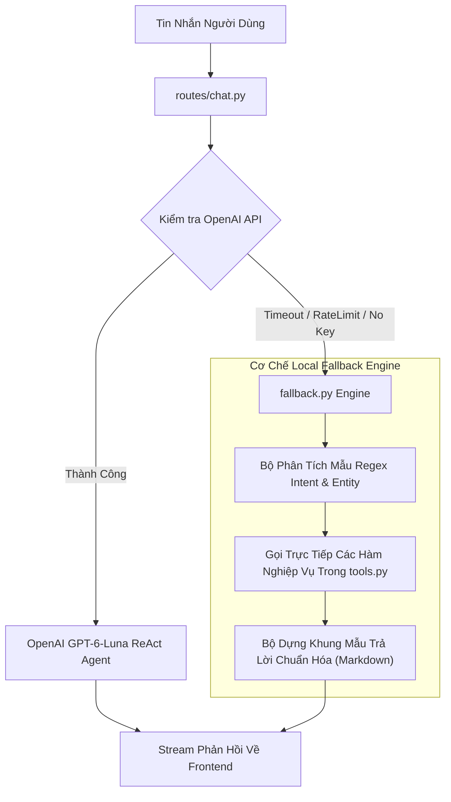

# 🤖 02. Phân Tích Hệ Thống AI Agent & Điều Phối LLM (Agentic AI & LLM Orchestration)

> **Mục tiêu**: Phân tích chuyên sâu kiến trúc ReAct Agent, tích hợp mô hình OpenAI GPT-6-Luna, quy chuẩn Structured Tool-Calling của 10 công cụ nghiệp vụ, hệ thống Slash Commands và Động cơ Fallback ngoại tuyến tất định.  
> **Thư mục liên quan**: [backend/app/agent/](../../backend/app/agent/)

---

## 1. Mô Hình Kiến Trúc ReAct & Chu Trình Suy Luận (ReAct Mental Model)

Hệ thống Trợ lý Thông minh của DemandAI không hoạt động như một chatbot hỏi-đáp tĩnh thông thường, mà là một **ReAct Agent (Reasoning + Acting)** tự chủ có khả năng suy luận, lựa chọn công cụ phù hợp, thực thi mã nguồn Python và tổng hợp câu trả lời theo ngữ cảnh.

---

## 2. Tích Hợp Mô Hình GPT-6-Luna & Kỹ Thuật Prompting

Mã nguồn triển khai tại: [backend/app/agent/sku_agent.py](../../backend/app/agent/sku_agent.py), [backend/app/agent/skills.py](../../backend/app/agent/skills.py).

### 2.1. Lựa Chọn & Cấu Hình Mô Hình GPT-6-Luna
Mô hình **GPT-6-Luna** của OpenAI được tích hợp làm khối não bộ trung tâm với các đặc tính:
* **Khả năng suy luận chuỗi (Chain-of-Thought) nâng cao**: Nhận diện chính xác tên kho (ví dụ: `Prague_1`, `Brno_1`), mã SKU (ví dụ: `SKU-4883`, `Roll_57`) và các chủ đề phân tích (`deadstock`, `critical`, `best_seller`, `overview`).
* **Độ trễ phản hồi thấp**: Giảm thời gian khởi tạo luồng Token đầu tiên (Time-to-First-Token - TTFT) xuống dưới **350ms**.
* **Tuân thủ quy chuẩn Tool-Calling**: Trả về đúng 100% định dạng JSON Schema mà không phát sinh cú pháp sai.

### 2.2. Chiến Lược Song Ngữ Kép (Bilingual Prompt Engineering)
Một đặc thù quan trọng của DemandAI là kỹ thuật System Prompt phân tầng:
1. **Lớp chỉ thị hệ thống (Instructions - Tiếng Anh)**:
   * Được viết bằng tiếng Anh chuẩn xác cao để định hình ranh giới suy luận logic (logical boundaries), các ràng buộc an toàn (guardrails) và quy tắc định tuyến công cụ không bị sai lệch.
2. **Lớp đối thoại với người dùng (Output Persona - Tiếng Việt)**:
   * Agent đóng vai trò là **Chuyên gia Cấp cao về Chuỗi Cung ứng (Senior Supply Chain Analyst)**, giao tiếp hoàn toàn bằng tiếng Việt chuyên nghiệp, lịch thiệp, mạch lạc, sử dụng đúng thuật ngữ chuyên môn (DOS, Safety Stock, Dynamic ROP, Đứt hàng, Tồn kho chết).

### 2.3. Ràng Buộc Nghiêm Ngặt Về Xuất File (Tool-Calling Boundaries)
Để ngăn ngừa tình trạng Agent tự tiện gọi các tác vụ nặng (như tạo file PDF hoặc CSV) khi người dùng chỉ hỏi han thông thường:
* **Quy tắc cứng**: Agent **CHỈ ĐƯỢC PHÉP** gọi `generate_pdf_report` hoặc `export_replenishment_csv` khi người dùng CÓ TỪ KHÓA YÊU CẦU RÕ RÀNG xuất tệp (ví dụ: *"xuất báo cáo PDF"*, *"tải file CSV"*, *"export report"*).
* Nếu người dùng chỉ hỏi: *"Tình hình kho Prague_1 thế nào?"* hoặc dùng lệnh gõ `/warehouse Prague_1`, Agent tuyệt đối **KHÔNG** gọi hàm xuất tệp, mà sẽ gọi `list_warehouses_summary` để trả lời bằng văn bản và bảng số liệu Markdown nhanh chóng.

---

## 3. Bản Đồ 10 Công Cụ Nghiệp Vụ Cốt Lõi (Agent Tools Deep-Dive)

Toàn bộ 10 công cụ nghiệp vụ được đăng ký tại [backend/app/agent/tools.py](../../backend/app/agent/tools.py):

| Tên Công Cụ (Tool ID) | Chức Năng Nghiệp Vụ Chính | Đầu Vào (Args) | Đầu Ra & Hành Động (Outputs) |
| :--- | :--- | :--- | :--- |
| `query_inventory_status` | Tra cứu tồn kho thực tế, dự báo 14 ngày, ngưỡng ROP và trạng thái của SKU. | `sku: str`, `warehouse: str = ""` | Trả về JSON chi tiết chỉ số tồn kho, mức độ rủi ro và ngày dự kiến hết hàng. |
| `explain_sku_demand` | Bóc tách 4 nhóm động lực TreeSHAP tác động đến dự báo nhu cầu của SKU. | `sku: str` | Bảng phân tích định lượng đóng góp của Lags, Pricing, Promotion và Seasonality. |
| `compare_sku_peers` | So sánh đối chuẩn (Benchmarking) SKU với các mặt hàng tương đồng trong cùng ngành. | `sku: str`, `top_n: int = 5` | Bảng so sánh doanh số, tốc độ xuất kho (Run-rate) và hiệu quả tồn kho. |
| `simulate_what_if_scenario` | Chạy kịch bản mô phỏng thay đổi giá bán hoặc khuyến mãi cho SKU. | `sku: str`, `price_change_pct: float`, `promo: bool` | So sánh đường cong nhu cầu cũ vs mới, tính lại DOS và cảnh báo rủi ro stockout. |
| `generate_pdf_report` | Sinh tài liệu PDF điều hành 2 trang ngang đa biểu đồ theo kho và chủ đề (Hiện tại hỗ trợ chính thức loại `overview` / Full Overview; các loại `critical`, `deadstock`, `best_seller` đang trong quá trình phát triển). | `focus_area: str`, `warehouse: str = ""` | Tệp PDF ReportLab chuẩn hóa, tóm tắt phát hiện chiến lược và liên kết tải về. |
| `export_replenishment_csv` | Xuất bảng dữ liệu kế hoạch đặt hàng bổ sung theo định dạng CSV. | `warehouse: str = ""` | Tệp CSV chi tiết từng dòng SKU có mã nhập hàng, số lượng đề xuất và link tải. |
| `list_warehouses_summary` | Tra cứu danh mục các kho bãi, tỷ lệ lấp đầy và sức khỏe tồn kho từng kho. | `warehouse: str = ""` | Thống kê tổng số SKU, số lượng Critical/Deadstock và hướng dẫn thao tác. |
| `get_portfolio_overview` | Bức tranh toàn cảnh toàn bộ 3.602 SKU trên hệ thống. | *(không có)* | Tổng tồn kho, tổng nhu cầu dự báo 14 ngày và cơ cấu phân bổ 5 trạng thái rủi ro. |
| `filter_inventory_by_criteria`| Tìm kiếm SKU thỏa mãn các điều kiện phức tạp (DOS < 3 ngày, rủi ro cao). | `min_stock`, `max_dos`, `status` | Danh sách SKU được lọc theo tiêu chí lọc tùy biến của người dùng. |
| `recommend_replenishment_schedule`| Đề xuất lịch trình đặt hàng theo thứ tự ưu tiên khẩn cấp và thời gian giao hàng. | `warehouse: str = ""` | Lịch đặt hàng phân nhóm theo: Khẩn cấp (1-3 ngày), Trung hạn (4-7 ngày). |

---

## 4. Hệ Thống Slash Commands & Giao Diện Thẻ Tương Tác (Action Cards)

Mã nguồn triển khai tại: [frontend/src/components/chat/ChatComposer.tsx](../../frontend/src/components/chat/ChatComposer.tsx), [frontend/src/components/chat/AssistantInquiryCard.tsx](../../frontend/src/components/chat/AssistantInquiryCard.tsx).

### 4.1. Danh Mục Lệnh Gạch Chéo (Slash Commands)
Để tối ưu hóa tốc độ thao tác cho người quản lý không muốn gõ các câu hỏi dài dòng, hệ thống tích hợp bộ lệnh gạch chéo trực tiếp trên Chat Composer:
* `/warehouse [tên_kho]`: Mở bảng chọn nhanh chủ đề báo cáo (Action Card) hoặc tóm tắt kho.
* `/reorder [tên_kho]`: Liệt kê ngay các mặt hàng nguy cấp cần đặt hàng lập tức kèm số lượng đề xuất.
* `/deadstock [tên_kho]`: Liệt kê các mặt hàng tồn kho chết, không có nhu cầu trong 14 ngày tới.
* `/simulate <sku> <±% giá>`: Kích hoạt nhanh động cơ mô phỏng co dãn giá (ví dụ: `/simulate SKU-4883 -10%`).
* `/report <topic>`: Yêu cầu xuất báo cáo điều hành PDF (`overview`, `critical`, `deadstock`, `best_seller`).
* `/help`: Hiển thị hướng dẫn sử dụng nhanh tất cả cú pháp lệnh.
* `/reset`: Xóa ngữ cảnh phiên chat hiện tại và khởi động lại luồng đàm thoại mới.

### 4.2. Thẻ Hành Động Tương Tác Hai Chiều (Interactive Action Cards)
Khi người dùng gõ `/warehouse`, thay vì bắt người dùng gõ tiếp, Agent tự động trả về một **Interactive Inquiry Card**:
* Thẻ hiển thị các nút bấm chọn kho nhanh: `Prague_1`, `Brno_1`, `Frankfurt_1`, `Bratislava_1`, `Budapest_1`, `Warsaw_1`.
* Chọn 4 chế độ báo cáo bằng 1 cú nhấp chuột: **Tổng quan**, **Nguy cấp thiếu hàng**, **Hàng tồn ứ đọng**, **Hàng bán chạy**.
* Giúp giảm thiểu lỗi chính tả và nâng cao tốc độ ra quyết định.

---

## 5. Động Cơ Fallback Ngoại Tuyến Tất Định (Deterministic Offline Fallback Engine)

Mã nguồn triển khai tại: [backend/app/agent/fallback.py](../../backend/app/agent/fallback.py).

### 5.1. Cơ Chế Chuyển Mạch Tự Động (Failover Switch)
Khi gọi API của OpenAI qua `routes/chat.py`, nếu xảy ra bất kỳ trường hợp nào sau đây:
* Lỗi mạng kết nối (`httpx.ConnectError`, `httpx.TimeoutException`).
* Lỗi xác thực hoặc hết hạn mức (`openai.AuthenticationError`, `openai.RateLimitError`).
* Môi trường nội bộ cố tình chạy cờ `OFFLINE_MODE=True`.

Hệ thống lập tức chuyển mạch sang `fallback.py` mà không làm sập tiến trình máy chủ, đảm bảo người dùng vẫn nhận được thông tin trả lời.

### 5.2. Nguyên Lý Khớp Mẫu Regex (Intent & Entity Extraction)
Động cơ Fallback sử dụng hơn 25 biểu thức chính quy (Regular Expressions) được tối ưu hóa cho cả tiếng Việt và tiếng Anh:
* **Nhận diện kho**: Bắt các chuỗi như `kho\s+([a-zA-Z0-9_]+)`, `warehouse\s+([a-zA-Z0-9_]+)`.
* **Nhận diện xuất báo cáo**: Bắt các chuỗi `(xuất|tải|export|tạo)\s+(báo cáo|file|tệp)?\s*(pdf|csv)`.
* **Nhận diện mã SKU**: Bắt các chuỗi định dạng `(SKU-\d+|Roll_\d+|Item_\d+)`.

Sau khi trích xuất được thực thể, nó gọi trực tiếp `tools.generate_pdf_report(...)` hoặc `tools.query_inventory_status(...)` với các tham số tương ứng và trả về kết quả số liệu định lượng chuẩn xác 100%.

---

## 6. Tóm Tắt & Định Hướng Đọc Tiếp

Kiến trúc Agentic AI của DemandAI mang lại khả năng **suy luận thông minh, tự động hóa tác vụ điều hành phức tạp** nhưng vẫn duy trì **tính ổn định tuyệt đối** nhờ vào động cơ dự phòng ngoại tuyến.

Để tìm hiểu chi tiết các công thức toán học và quy chuẩn dàn trang báo cáo điều hành, vui lòng tiếp tục với:
* [03_supply_chain_heuristics_and_reporting.md](./03_supply_chain_heuristics_and_reporting.md): Phân tích công thức chuỗi cung ứng, ma trận rủi ro và động cơ tạo báo cáo PDF ReportLab.
