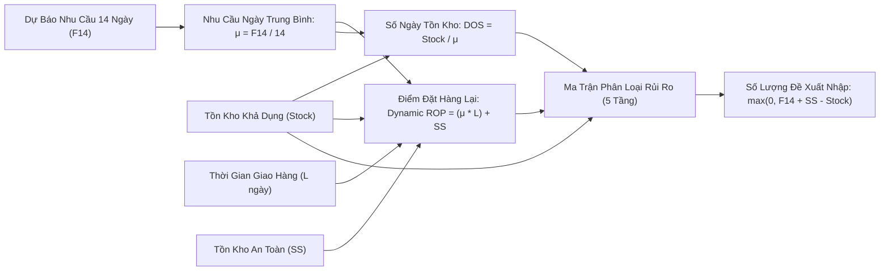

# 📦 03. Phân Tích Nghiệp Vụ Chuỗi Cung Ứng & Động Cơ Báo Cáo (SCM Heuristics & Reporting Engine)

> **Mục tiêu**: Phân tích chi tiết các mô hình toán học Quản trị Chuỗi Cung ứng (SCM Formulations), ma trận phân loại rủi ro tồn kho 5 tầng, kiến trúc tạo tài liệu điều hành PDF 2 trang ngang bằng ReportLab và quy trình quản trị vòng đời tệp xuất khẩu.  
> **Thư mục liên quan**: [backend/app/services/](../../backend/app/services/)

---

## 1. Bản Chất Nghiệp Vụ Chuỗi Cung Ứng (SCM Domain Logic)

Hệ thống DemandAI không chỉ dừng lại ở việc dự báo con số bán hàng tương lai, mà chuyển hóa con số dự báo đó thành **quyết định vận hành chuỗi cung ứng cụ thể**: Khi nào cần đặt hàng? Cần đặt bao nhiêu? Kho nào cần điều chuyển gấp? Mặt hàng nào cần dừng nhập để giải phóng dòng tiền?

Toàn bộ các quy tắc này được mã hóa tập trung tại: [backend/app/services/report_data_service.py](../../backend/app/services/report_data_service.py).

---

## 2. Các Mô Hình Toán Học SCM Cốt Lõi (Mathematical Formulations)



### 2.1. Nhu Cầu Tiêu Thụ Hàng Ngày Trung Bình (Average Daily Demand)
Cho dự báo tổng sản lượng bán trong 14 ngày tới là $F_{14d}$:
$$\mu_{\text{daily}} = \frac{F_{14d}}{14}$$
* Nếu $F_{14d} = 0$: Hệ thống đánh dấu $\mu_{\text{daily}} = 0$ (Không có nhu cầu tiêu thụ trong 2 tuần tới).
* Nếu $F_{14d}$ bị khuyết thiếu (Missing Data): Đánh dấu trạng thái dữ liệu không khả dụng, không nội suy bừa bãi.

### 2.2. Điểm Đặt Hàng Lại Động (Dynamic Reorder Point - Dynamic ROP)
Trong các hệ thống ERP truyền thống, ROP thường là một con số tĩnh do con người cài đặt thủ công. Trong DemandAI, ROP được tính toán lại theo thời gian thực dựa trên nhu cầu dự báo:
$$\text{ROP}_{\text{dynamic}} = \left(\mu_{\text{daily}} \times L\right) + \text{SS}$$
Trong đó:
* $L$: Thời gian giao hàng từ nhà cung cấp (*Supplier Lead Time* tính bằng ngày).
* $\mu_{\text{daily}} \times L$: Lượng hàng hóa dự kiến sẽ tiêu thụ trong suốt thời gian chờ hàng về.
* $\text{SS}$: Ngưỡng tồn kho an toàn (*Safety Stock*).

### 2.3. Tồn Kho An Toàn (Safety Stock - SS)
Tồn kho an toàn là lớp đệm phòng ngừa sự biến động bất thường của nhu cầu và sự chậm trễ của nhà cung cấp:
$$\text{SS} = Z \times \sigma_d \times \sqrt{L}$$
Trong đó:
* $Z$: Hệ số độ tin cậy dịch vụ (Service Level Factor). Hệ thống áp dụng $Z = 1.65$ tương ứng với tỷ lệ phục vụ khách hàng đạt 95%.
* $\sigma_d$: Độ lệch chuẩn của nhu cầu bán lẻ hàng ngày trong quá khứ.

### 2.4. Số Ngày Tồn Kho Khả Dụng (Days of Supply - DOS)
Chỉ số cho biết với lượng tồn kho hiện có, kho hàng sẽ duy trì bán được trong bao nhiêu ngày nữa nếu không nhập thêm hàng:
$$\text{DOS} = \begin{cases} 
\frac{\text{Current Stock}}{\mu_{\text{daily}}} & \text{khi } \mu_{\text{daily}} > 0 \\
\infty \text{ (N/A Zero Demand)} & \text{khi } \mu_{\text{daily}} = 0 \text{ và Current Stock} > 0 \\
0 & \text{khi Current Stock} = 0 
\end{cases}$$

### 2.5. Số Lượng Đề Xuất Bổ Sung Hàng (Preliminary Replenishment Target)
Lượng hàng cần đặt thêm để vừa đủ phục vụ nhu cầu 14 ngày tới, vừa bù đắp lại mức tồn kho an toàn:
$$\text{ReplenishTarget} = \max\left(0, \left\lceil F_{14d} + \text{SS} - \text{Current Stock} \right\rceil\right)$$
*(Lưu ý: Đây là con số nhu cầu ròng lý thuyết, chưa tính đến số lượng tối thiểu của nhà cung cấp MOQ hoặc các đơn hàng đang trên đường vận chuyển On-Order).*

---

## 3. Ma Trận Phân Loại Rủi Ro Tồn Kho 5 Tầng (5-Tier Risk Matrix)

Hệ thống phân chia toàn bộ danh mục thành 5 trạng thái rủi ro theo thứ tự ưu tiên xử lý:

| Trạng Thái | Điều Kiện Kỹ Thuật (Logic Rules) | Ý Nghĩa Vận Hành | Hành Động Đề Xuất Chuẩn |
| :--- | :--- | :--- | :--- |
| **Critical** (Nguy Cấp) | $\text{Current Stock} \le \text{SS}$ hoặc $\text{DOS} \le 3.0$ ngày | Tồn kho đã thủng đáy an toàn; nguy cơ đứt hàng trong vòng 72 giờ tới. | **Ưu tiên điều chuyển kho nội bộ gấp** hoặc yêu cầu nhà cung cấp giao hỏa tốc (*Expedite Shipment*). |
| **Reorder** (Cần Đặt Hàng) | $\text{Current Stock} \le \text{ROP}_{\text{dynamic}}$ | Lượng hàng còn lại không đủ duy trì trong thời gian chờ nhà cung cấp giao ($L$ ngày). | **Phát hành đơn đặt hàng ngay lập tức** theo số lượng `ReplenishTarget`. |
| **Monitor** (Cần Theo Dõi) | $\text{ROP}_{\text{dynamic}} < \text{Current Stock} \le 1.2 \times \text{ROP}_{\text{dynamic}}$ | Tồn kho đang tiệm cận điểm đặt hàng lại (trong biên độ 20%). | Theo dõi sát tốc độ xuất kho hàng ngày, kiểm tra xác nhận Lead Time với nhà cung cấp. |
| **In Stock** (Khỏe Mạnh) | $\text{Current Stock} > 1.2 \times \text{ROP}_{\text{dynamic}}$ và $\text{DOS} \le 60$ ngày | Tồn kho cân đối, đảm bảo cung ứng bình thường mà không bị thừa vốn. | Duy trì chu kỳ cung ứng định kỳ; không cần can thiệp đột xuất. |
| **Deadstock** (Tồn Kho Chết) | $\text{DOS} > 60$ ngày hoặc ($F_{14d} \approx 0$ và $\text{Stock} > 0$) | Hàng tồn đọng lâu ngày, nhu cầu gần như bằng 0; đang chiếm dụng vốn lưu động và diện tích kho. | **Tạm dừng toàn bộ đơn đặt hàng mới**; áp dụng chương trình giảm giá xả hàng hoặc chuyển về kho trung tâm thanh lý. |

---

## 4. Kiến Trúc Động Cơ Tạo Báo Cáo PDF Điều Hành (Executive PDF Engine)

> [!NOTE]
> **Trạng thái triển khai các chủ đề báo cáo**: Hiện tại hệ thống hỗ trợ chính thức cho chủ đề **Full Overview** (`overview`). Ba phân hệ báo cáo chuyên biệt gồm **Critical Stockout** (`critical`), **Deadstock** (`deadstock`), và **Best Sellers** (`best_seller`) đang trong quá trình phát triển (In Development) và sẽ được hoàn thiện trong các bản phát hành tiếp theo.

Mã nguồn triển khai tại: [backend/app/services/pdf_report_generator.py](../../backend/app/services/pdf_report_generator.py).

Khác với các công cụ tạo PDF thông thường dựa trên HTML-to-PDF (thường cồng kềnh, chậm và dễ lỗi ngắt trang), DemandAI sử dụng **ReportLab Platypus Engine** thuần Python để vẽ trực tiếp tài liệu theo tọa độ hình học chính xác tuyệt đối.

### 4.1. Quy Chuẩn Bố Cục Hình Học 2 Trang Ngang (2-Page Landscape Architecture)
* **Kích thước trang**: Khổ giấy `Landscape Letter` chuẩn Mỹ ($792 \text{ pt} \times 612 \text{ pt} \approx 279.4\text{mm} \times 215.9\text{mm}$).
* **Lề trang (Margins)**: Trái = Phải = $28.8\text{ pt}$ ($0.4\text{ inch}$), Trên = Dưới = $32.0\text{ pt}$ ($0.44\text{ inch}$). Chiều rộng in khả dụng: $W = 734.4\text{ pt}$.
* **Quy tắc 2 trang nghiêm ngặt**:
  * **Trang 1**: Dành trọn vẹn cho Bức tranh Điều hành Cấp cao (Executive Briefing & Visual Analytics).
  * **Trang 2**: Dành trọn vẹn cho Bảng Kế hoạch Hành động Ưu tiên (Prioritized Action Plan Table).

```
┌─────────────────────────────────────────────────────────────────────────────┐
│ TRANG 1: EXECUTIVE BRIEFING DASHBOARD                                       │
│ ┌─────────────────────────────────────────────────────────────────────────┐ │
│ │ HEADER: Tên báo cáo • Kho áp dụng • Thời gian xuất • Phạm vi SKU         │ │
│ ├───────────────────┬───────────────────┬────────────────┬────────────────┤ │
│ │ Total SKUs        │ Stock On-Hand     │ 14-Day Demand  │ Replenishment  │ │
│ │ 3,602 records     │ 48,250 units      │ 52,100 units   │ 14,800 units   │ │
│ ├───────────────────┴───────────────────┴────────────────┴────────────────┤ │
│ │ [BIỂU ĐỒ 1: DONUT CHART PHÂN BỔ RỦI RO]   [BIỂU ĐỒ 2: BAR CHART TOP SKU]│ │
│ ├─────────────────────────────────────────────────────────────────────────┤ │
│ │ EXECUTIVE STRATEGIC FINDINGS (DATA-DRIVEN OBSERVATIONS)                 │ │
│ │ 1. Phạm vi bao phủ 3.602 SKU; tổng tồn kho đáp ứng 92% nhu cầu 14 ngày. │ │
│ │ 2. Phát hiện 142 mặt hàng Critical và 318 mặt hàng Reorder (12.7%).      │ │
│ │ 3. Có 8 nhà cung cấp có Lead time > 14 ngày, cần lên kế hoạch trung hạn. │ │
│ └─────────────────────────────────────────────────────────────────────────┘ │
└─────────────────────────────────────────────────────────────────────────────┘
                                  [PAGE BREAK]
┌─────────────────────────────────────────────────────────────────────────────┐
│ TRANG 2: PRIORITY ACTION PLAN (TOP FOCUS ITEMS)                             │
│ ┌─────────────────────────────────────────────────────────────────────────┐ │
│ │ SECTION C: BẢNG KẾ HOẠCH HÀNH ĐỘNG ƯU TIÊN — TOP 15 MẶT HÀNG TRỌNG TÂM   │ │
│ ├──────┬──────────────┬──────┬──────┬──────┬─────┬────┬────┬────┬──────┬──────┤ │
│ │SKU   │Tên SP [Risk] │Kho   │Stock │F14   │DOS  │LT  │SS  │ROP │Target│Lý do & Hành động đề xuất │
│ ├──────┼──────────────┼──────┼──────┼──────┼─────┼────┼────┼────┼──────┼──────┤ │
│ │SKU-48│Roll_57 [Crit]│Prague│120   │450   │3.7d │7d  │150 │375 │480   │Thủng SS. Chuyển kho gấp  │
│ │SKU-12│Soap_22 [Reor]│Brno_1│310   │620   │7.0d │14d │200 │820 │510   │Dưới ROP. Đặt hàng ngay   │
│ │...   │...           │...   │...   │...   │...  │... │... │... │...   │...   │
│ └──────┴──────────────┴──────┴──────┴──────┴─────┴────┴────┴────┴──────┴──────┘ │
│ Trang 2 / 2                                          DemandAI Executive Briefing│
└─────────────────────────────────────────────────────────────────────────────┘
```

### 4.2. Cơ Chế Nhúng Biểu Đồ Động (Matplotlib Headless Buffer)
Hệ thống không lưu ảnh biểu đồ ra đĩa cứng rồi đọc lại (gây chậm I/O), mà kết xuất trực tiếp vào bộ nhớ RAM thông qua `io.BytesIO()`:
* **Donut Chart**: Thể hiện tỷ lệ % các trạng thái rủi ro. Các góc lát cắt nhỏ hơn 3% được ẩn nhãn để tránh đè chữ; bảng chú giải (Legend) được đặt ở đáy hộp.
* **Horizontal Bar Chart**: Thể hiện Top 8 SKU theo sản lượng cần nhập (với báo cáo Critical), lượng tồn kho ứ đọng (với báo cáo Deadstock) hoặc lượng tiêu thụ dự kiến (với báo cáo Best-seller).
* Định dạng màu sắc nhận diện tự động thay đổi theo chủ đề: Màu đỏ cam cho Critical, đỏ thẫm cho Deadstock, xanh ngọc cho Best-seller, và xanh navy cho Overview.

### 4.3. Thuật Toán Tự Động Sinh Nhận Xét Chiến Lược (Automated Strategic Findings)
Triển khai tại hàm `build_executive_insights()`:
* Không dựa vào LLM bên ngoài để tránh ảo giác số liệu.
* Tự động quét toàn bộ mảng dữ liệu đã nạp và sinh ra từ **3 đến 5 nhận xét định lượng sắc bén**:
  1. *Quy mô tổng thể*: Tổng SKU, tổng tồn kho và tỷ lệ đáp ứng nhu cầu 14 ngày.
  2. *Cơ cấu rủi ro*: Số lượng và tỷ trọng % của Critical và Reorder.
  3. *Quy mô vốn nhập hàng*: Tổng số lượng hàng cần đặt bổ sung theo kịch bản cơ sở.
  4. *Ràng buộc Lead Time*: Cảnh báo các nhà cung cấp có thời gian giao hàng vượt quá 14 ngày.
  5. *Điểm nóng đơn lẻ*: Nêu đích danh SKU nguy cấp nhất tại kho nào và số ngày tồn kho còn lại.

---

## 5. Động Cơ Xuất CSV & Quản Trị Vòng Đời Tệp (Artifacts Lifecycle)

Mã nguồn triển khai tại: [backend/app/services/forecast_artifacts.py](../../backend/app/services/forecast_artifacts.py).

### 5.1. Định Dạng Tên Tệp Tiêu Chuẩn (Standardized File Naming)
Để phục vụ việc lưu trữ, đối soát và tích hợp hệ thống ERP của doanh nghiệp, mọi tệp xuất ra đều tuân theo cú pháp:
$$\text{report\_\{TOPIC\}\_\{WAREHOUSE\}\_\{YYYYMMDD\}\_\{HHMMSS\}.\{pdf|csv\}}$$
*Ví dụ*: `report_critical_prague_1_20260924_143000.pdf`

### 5.2. Cơ Chế Tự Động Dọn Dẹp (Auto-Pruning Strategy)
Mỗi khi một tệp xuất khẩu mới được tạo ra trong `backend/data/exports/`:
* Hàm `prune_old_exports(keep_n=5)` tự động quét thư mục xuất khẩu.
* Chỉ duy trì tối đa 5 tệp gần nhất cho mỗi loại định dạng.
* Tự động xóa vĩnh viễn các tệp cũ hơn để bảo vệ dung lượng lưu trữ của máy chủ, tránh nguy cơ tràn ổ cứng trong quá trình vận hành lâu dài.

---

## 6. Tóm Tắt & Định Hướng Đọc Tiếp

Hệ thống SCM Heuristics và Động cơ Báo cáo của DemandAI đảm bảo tính **chính xác toán học 100%**, chuyển hóa các con số dự báo trừu tượng thành **tài liệu điều hành trực quan, chuyên nghiệp và có thể hành động được ngay**.

Để tìm hiểu chi tiết về thiết kế Cơ sở dữ liệu và tối ưu hiệu năng I/O, vui lòng tiếp tục với:
* [04_database_performance_and_security.md](./04_database_performance_and_security.md): Phân tích lược đồ PostgreSQL RDS, Parquet Caching, Non-blocking I/O và an toàn dữ liệu.
