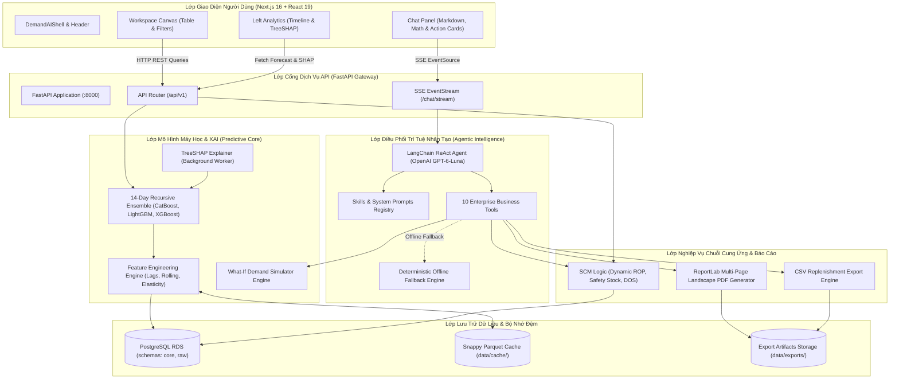

# 🏛️ DemandAI - Bộ Tài Liệu Phân Tích Hệ Thống Toàn Diện
> **System Architecture, Technical Design & Deep-Dive Analysis Suite**  
> *Phiên bản: 2.4.0 • Cập nhật: 2026-09 • Trọng tâm: Production Architecture & Technical Excellence*

---

## 📌 Giới Thiệu Bộ Tài Liệu

Tài liệu này được biên soạn nhằm cung cấp bức tranh phân tích kỹ thuật toàn diện, có hệ thống và chuyên sâu về nền tảng **DemandAI** (Hệ thống dự báo nhu cầu bán lẻ và trợ lý điều hành chuỗi cung ứng thông minh).

Khác với tài liệu hướng dẫn kỹ sư mới ([developer_guide.md](../developer_guide.md)) hay hướng dẫn người dùng cuối ([user_guide.md](../user_guide.md)), bộ tài liệu **System Analysis** này đi sâu vào:
1. **Kiến trúc phân tầng và mô hình tinh thần (Mental Model)** của hệ thống.
2. **Nguyên lý toán học & thuật toán ML/XAI** của pipeline dự báo đệ quy 14 ngày.
3. **Cơ chế điều phối Trợ lý AI (Agentic AI & ReAct Orchestration)** với mô hình GPT-6-Luna.
4. **Logic nghiệp vụ Chuỗi cung ứng (Supply Chain Heuristics)** và động cơ sinh báo cáo PDF/CSV.
5. **Thiết kế Cơ sở dữ liệu, Caching Parquet, Hiệu năng và An toàn vận hành**.

---

## 🗺️ Bản Đồ Điều Hướng Bộ Tài Liệu (Navigation Matrix)

```
docs/system_analysis/
├── README.md                                    # Tài liệu dẫn nhập & Sơ đồ tổng thể
├── 00_system_overview_and_mental_model.md       # Bức tranh kiến trúc, mô hình C4 & luồng E2E
├── 01_data_and_ml_pipeline_analysis.md          # Pipeline dự báo đệ quy 14 ngày & TreeSHAP
├── 02_agentic_ai_and_llm_orchestration.md       # ReAct Agent, GPT-6-Luna, 10 Tools & Fallback
├── 03_supply_chain_heuristics_and_reporting.md   # Công thức SCM, ma trận rủi ro & PDF Engine
└── 04_database_performance_and_security.md      # PostgreSQL, Parquet Cache, Concurrency & CI/CD
```

### Chi Tiết Từng Tập Tài Liệu:

| Tập Tài Liệu | Trọng Tâm Phân Tích | Đối Tượng Mục Tiêu | Liên Kết Nhanh |
| :--- | :--- | :--- | :--- |
| **00. Tổng Quan & Kiến Trúc** | Mô hình C4 (Context, Container, Component, Code), luồng dữ liệu E2E, phân tích các quyết định thiết kế (Trade-offs: SSE vs WebSocket, Parquet vs RDS, Double-tier Fallback). | Solutions Architect, Tech Lead, Engineering Manager | [Đọc tài liệu 00](./00_system_overview_and_mental_model.md) |
| **01. ML Pipeline & XAI** | Recursive Multi-Model Ensemble (CatBoost, LightGBM, XGBoost), 4 nhóm đặc trưng (Lags, Price, Promo, Seasonality), TreeSHAP background worker, What-If Simulation Engine. | ML Engineer, Data Scientist, Algorithm Specialist | [Đọc tài liệu 01](./01_data_and_ml_pipeline_analysis.md) |
| **02. AI Agent & LLM** | ReAct Pattern (LangChain/LangGraph), GPT-6-Luna System Prompt, Structured Tool-Calling, Bản đồ 10 công cụ nghiệp vụ, Slash Commands và Local Fallback Engine. | AI Engineer, Fullstack Engineer, Prompt Specialist | [Đọc tài liệu 02](./02_agentic_ai_and_llm_orchestration.md) |
| **03. SCM & Reporting Engine** | Công thức toán học SCM (Dynamic ROP, Safety Stock, DOS), ma trận 5 trạng thái tồn kho, kiến trúc ReportLab 2-trang Landscape PDF, nhúng biểu đồ Matplotlib, CSV streaming. | Supply Chain Analyst, Backend Engineer, Business Analyst | [Đọc tài liệu 03](./03_supply_chain_heuristics_and_reporting.md) |
| **04. Database & Hiệu Năng** | Schema `core` và `raw` trên PostgreSQL RDS, B-Tree Indexes, Snappy Parquet Cache, Non-blocking I/O với FastAPI BackgroundTasks, bảo mật & Alembic. | Database Administrator, DevOps Engineer, Backend Lead | [Đọc tài liệu 04](./04_database_performance_and_security.md) |

---

## 🏛️ Sơ Đồ Kiến Trúc Hệ Thống Tổng Thể



---

## 🛠️ Quy Chuẩn Đọc & Tham Chiếu Mã Nguồn

* Mọi tài liệu đều liên kết trực tiếp đến mã nguồn thực tế đang chạy tại các thư mục:
  * Backend: [backend/app/](../../backend/app/)
  * Frontend: [frontend/src/](../../frontend/src/)
  * Dữ liệu & Cache: [backend/data/](../../backend/data/)
* Các công thức toán học được chuẩn hóa theo định dạng ký hiệu $\LaTeX$ đồng bộ với bộ thư viện KaTeX trên frontend.
