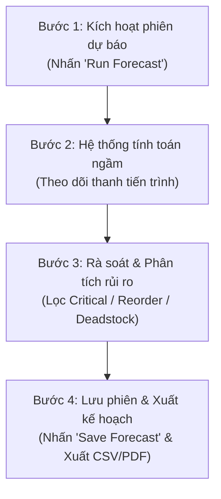

# 🛒 DemandAI - Hướng Dẫn Sử Dụng Nền Tảng Dành Cho Người Dùng Cuối (End-User Guide)
> **Tài Liệu Vận Hành Dành Cho**: Quản Trị Viên Chuỗi Cung Ứng (Supply Chain Manager) • Chuyên Viên Kế Hoạch Tồn Kho (Inventory Planner) • Quản Lý Kho & Cửa Hàng (Warehouse & Store Manager)  
> *Được biên soạn theo phương pháp cộng tác `doc-coauthoring`: trực quan, súc tích, gắn liền với các tình huống nghiệp vụ kinh doanh thực tế.*

---

## 📑 Mục Lục
1. [Giới Thiệu Nền Tảng & Tổng Quan Giao Diện (Platform & UI Tour)](#1-giới-thiệu-nền-tảng--tổng-quan-giao-diện-platform--ui-tour)
2. [Quy Trình 4 Bước Vận Hành Dự Báo 14 Ngày (Daily Operational Workflow)](#2-quy-trình-4-bước-vận-hành-dự-báo-14-ngày-daily-operational-workflow)
3. [Đọc Hiểu Bảng Dữ Liệu & Chỉ Số Cảnh Báo Tồn Kho (Table & Risk Metrics)](#3-đọc-hiểu-bảng-dữ-liệu--chỉ-số-cảnh-báo-tồn-kho-table--risk-metrics)
4. [Phân Tích Động Lực Biến Động Doanh Số Với TreeSHAP (Explainability Guide)](#4-phân-tích-động-lực-biến-động-doanh-số-với-treeshap-explainability-guide)
5. [Khai Thác Trợ Lý Ảo Thông Minh & Cẩm Nang Slash Commands (AI Assistant & Commands)](#5-khai-thác-trợ-lý-ảo-thông-minh--cẩm-nang-slash-commands-ai-assistant--commands)
   - [5.1. Cách Đàm Thoại Tự Nhiên](#51-cách-đàm-thoại-tự-nhiên)
   - [5.2. Cẩm Nang Câu Lệnh Nhanh (Slash Commands)](#52-cẩm-nang-câu-lệnh-nhanh-slash-commands)
   - [5.3. Hộp Thoại Chọn Kho Thông Minh & 4 Chế Độ Báo Cáo](#53-hộp-thoại-chọn-kho-thông-minh--4-chế-độ-báo-cáo)
   - [5.4. Quy Chuẩn Báo Cáo Quản Trị PDF & CSV Chuẩn Hóa](#54-quy-chuẩn-báo-cáo-quản-trị-pdf--csv-chuẩn-hóa)
   - [5.5. Mô Phỏng Kịch Bản Giả Lập What-If (Demand Simulation)](#55-mô-phỏng-kịch-bản-giả-lập-what-if-demand-simulation)
6. [Xuất Kế Hoạch Đặt Hàng CSV & Báo Cáo Quản Trị PDF (Exports & Reports)](#6-xuất-kế-hoạch-đặt-hàng-csv--báo-cáo-quản-trị-pdf-exports--reports)
7. [Cẩm Nang Xử Lý Tình Huống Thực Tế & Câu Hỏi Thường Gặp (FAQs & Scenarios)](#7-cẩm-nang-xử-lý-tình-huống-thực-tế--câu-hỏi-thường-gặp-faqs--scenarios)

---

## 1. Giới Thiệu Nền Tảng & Tổng Quan Giao Diện (Platform & UI Tour)

### 1.1. DemandAI Giúp Gì Cho Công Việc Của Bạn?
Là một nhà quản lý chuỗi cung ứng hoặc kế hoạch kho bãi, bạn thường xuyên phải đối mặt với hai bài toán đau đầu:
- **Thiếu hàng (Stockout)**: Hàng bán chạy hết đột ngột, mất doanh thu, khách hàng chuyển sang đối thủ.
- **Tồn ứ đọng vốn (Deadstock/Overstock)**: Đặt hàng quá nhiều, hàng nằm chết trong kho nhiều tháng, tốn chi phí lưu kho và rủi ro hết hạn/hư hỏng.

**DemandAI** giải quyết triệt để vấn đề này bằng cách:
1. **Dự báo chính xác nhu cầu 14 ngày tới** cho toàn bộ hơn 3.600 mặt hàng (SKU) trên hệ thống.
2. **Cảnh báo sớm rủi ro** theo mức độ khẩn cấp (Critical, Reorder, Monitor, Deadstock).
3. **Bóc tách nguyên nhân** vì sao nhu cầu tăng hay giảm (do đà bán, do giá, khuyến mãi hay mùa vụ).
4. **Trợ lý ảo AI đàm thoại**: Bạn chỉ cần gõ lệnh như chat với đồng nghiệp để hỏi số liệu kho, tính toán số lượng cần nhập hoặc xuất file báo cáo.

---

### 1.2. Bố Cục Không Gian Làm Việc (Dashboard Layout)

Giao diện DemandAI được thiết kế chia làm 4 khu vực trực quan:

```
┌────────────────────────────────────────────────────────────────────────────────────────┐
│ [LOGO] DemandAI Retail Forecasting     [STATUS: Active Run]   [Run Forecast] [Save Run]│ <- HEADER
├────────────────────────┬───────────────────────────────────────────────┬───────────────┤
│ BẢNG PHÂN TÍCH BÊN TRÁI │ KHÔNG GIAN LÀM VIỆC TRUNG TÂM (CANVAS)       │ TRỢ LÝ ẢO AI  │
│ (LEFT ANALYTICS)       │ (WORKSPACE CANVAS)                            │ (CHAT PANEL)  │
│                        │                                               │               │
│ • Biểu đồ đường xu     │ • Bộ lọc: Trạng thái, Ngành hàng, Kho bãi     │ • Lịch sử hỏi │
│   hướng 14 ngày        │ • Ô tìm kiếm SKU / Tên mặt hàng               │   đáp số liệu │
│                        │ • BẢNG DỮ LIỆU CHÍNH (3.602 SKU):             │ • Khung nhập  │
│ • Biểu đồ thanh ngang  │   - Mã SKU & Tên sản phẩm                     │   câu hỏi &   │
│   TreeSHAP 4 nhóm:     │   - Nhu cầu dự báo 14 ngày tới                │   lệnh gạch   │
│     - Lags (Lịch sử)   │   - Tồn kho thực tế hiện tại                  │   chéo /slash │
│     - Price (Giá bán)  │   - Trạng thái rủi ro (Huy hiệu màu)          │               │
│     - Promo (Khuyến mãi│   - Số ngày tồn kho an toàn                   │               │
│     - Season (Mùa vụ)  │ • Phân trang dữ liệu                          │               │
└────────────────────────┴───────────────────────────────────────────────┴───────────────┘
```

1. **Thanh Tiêu Đề (Header Bar)**:
   - **Status Badge**: Cho biết bạn đang xem phiên dự báo lưu chính thức trên hệ thống (*Saved RDS*) hay phiên chạy thử nghiệm tạm thời (*In-Memory Cache*).
   - **Nút "Run Forecast"**: Kích hoạt chạy một lượt tính toán dự báo mới cho toàn bộ danh mục hàng hóa.
   - **Nút "Save Forecast"**: Lưu vĩnh viễn kết quả của phiên dự báo hiện tại vào cơ sở dữ liệu.
2. **Không Gian Làm Việc Trung Tâm (Workspace Canvas)**:
   - Nơi hiển thị bảng danh mục hơn 3.600 mặt hàng cùng đầy đủ các chỉ số tồn kho và phân loại rủi ro.
   - Hỗ trợ tìm kiếm tức thì theo tên, lọc theo từng kho hàng, từng ngành hàng và sắp xếp cột theo nhu cầu phân tích.
3. **Bảng Phân Tích Bên Trái (Left Analytics Panel)**:
   - Tự động cập nhật số liệu chuyên sâu khi bạn **nhấp chuột vào bất kỳ dòng SKU nào** trong bảng trung tâm.
   - Bao gồm: Biểu đồ đường dự báo từng ngày trong 14 ngày tới và Biểu đồ bóc tách nguyên nhân TreeSHAP.
4. **Trợ Lý Đàm Thoại AI (Chat Panel)**:
   - Trợ lý thông minh sẵn sàng hỗ trợ giải đáp mọi thắc mắc, phân tích so sánh, tạo kế hoạch đặt hàng và xuất file báo cáo.

---

## 2. Quy Trình 4 Bước Vận Hành Dự Báo 14 Ngày (Daily Operational Workflow)

Mỗi ngày hoặc mỗi chu kỳ lập kế hoạch (tuần/tháng), bạn hãy thực hiện theo quy trình 4 bước chuẩn sau:



### Bước 1: Kích Hoạt Phiên Dự Báo (Run Forecast)
- Tại góc trên bên phải màn hình, nhấp vào nút màu xanh **"Run Forecast"**.
- Hệ thống sẽ tự động tổng hợp dữ liệu lịch sử bán hàng gần nhất của toàn bộ 3.602 mặt hàng trên khắp các kho để chuẩn bị tính toán.

### Bước 2: Theo Dõi Quá Trình Tính Toán
- Khi phiên dự báo khởi chạy, bạn sẽ thấy trạng thái chuyển sang màu cam **"Computing 14d Forecast..."**.
- Nhờ công nghệ bộ nhớ đệm tốc độ cao, quá trình này diễn ra tự động. Bạn hoàn toàn có thể tiếp tục xem các số liệu hiện có trong lúc chờ đợi.

### Bước 3: Rà Soát & Phân Tích Danh Mục Cảnh Báo
- Khi hoàn tất, bảng dữ liệu trung tâm sẽ cập nhật số liệu mới nhất.
- Bạn hãy sử dụng bộ lọc trạng thái để ưu tiên xử lý:
  - **Ưu tiên 1**: Chọn lọc **`Critical`** để xem những mặt hàng sắp cạn kho trong 1–3 ngày tới.
  - **Ưu tiên 2**: Chọn lọc **`Reorder`** để lập danh sách hàng cần đặt bổ sung theo định kỳ.
  - **Ưu tiên 3**: Chọn lọc **`Deadstock`** để phát hiện hàng ứ đọng vốn lâu ngày.

### Bước 4: Lưu Phiên Dự Báo & Xuất Kế Hoạch Đặt Hàng
- Khi đã hài lòng với kết quả phân tích, nhấp vào nút **"Save Forecast"** trên thanh tiêu đề để ghi nhận phiên làm việc vào lịch sử hệ thống.
- Sử dụng Trợ lý AI (gõ `/warehouse` hoặc `/reorder`) để xuất file CSV kế hoạch đặt hàng gửi cho bộ phận Mua hàng (*Procurement*).

---

## 3. Đọc Hiểu Bảng Dữ Liệu & Chỉ Số Cảnh Báo Tồn Kho (Table & Risk Metrics)

### 3.1. Bảng 5 Trạng Thái Tồn Kho (Inventory Status Guide)

Hệ thống tự động phân loại từng mặt hàng vào 1 trong 5 trạng thái với màu sắc trực quan:

| Trạng Thái (Status) | Màu Sắc | Ý Nghĩa Nghiệp Vụ | Hành Động Khuyến Nghị |
|---|---|---|---|
| **`Critical`** | 🔴 Đỏ | **Nguy cấp - Sắp cạn kho**: Số lượng tồn kho hiện tại chỉ đủ bán dưới ngưỡng thời gian giao hàng (Lead Time). Mặt hàng sẽ hết sạch trong vòng 1-3 ngày tới! | **Ưu tiên khẩn cấp**: Tạo đơn đặt hàng gấp (*Emergency PO*) hoặc điều chuyển hàng từ kho lân cận sang ngay lập tức. |
| **`Reorder`** | 🟡 Vàng | **Cần đặt hàng**: Tồn kho đã chạm hoặc giảm xuống dưới Điểm Đặt Hàng An Toàn (*Reorder Point - ROP*). | **Lập đơn hàng**: Đặt thêm hàng theo số lượng khuyến nghị của hệ thống để kịp hàng về trước khi cạn kho. |
| **`Monitor`** | 🔵 Xanh dương | **Cần theo dõi**: Tồn kho đang ở mức trung bình, vẫn an toàn trong ngắn hạn nhưng có thể chạm điểm đặt hàng trong tuần tới. | **Giữ nguyên**: Theo dõi biến động doanh số, chưa cần đặt thêm hàng ngay. |
| **`In Stock`** | 🟢 Xanh lá | **Tồn kho dồi dào**: Tồn kho dồi dào, đáp ứng hoàn toàn nhu cầu dự kiến trong 14 ngày tới cộng với lượng tồn kho an toàn quy định. | **Hoạt động bình thường**: Không cần can thiệp. |
| **`Deadstock`** | ⚪ Xám đậm | **Hàng tồn ứ đọng**: Tồn kho rất lớn nhưng nhu cầu dự báo 14 ngày gần như bằng 0 hoặc bán cực chậm trong thời gian dài. | **Giải phóng vốn**: Xem xét giảm giá xả hàng, gộp khuyến mãi (combo) hoặc trả lại nhà cung ứng nếu có chính sách. |

---

### 3.2. Chỉ Số "Số Ngày Tồn Kho An Toàn" (Days of Supply - DoS)

$$ \text{Days of Supply (DoS)} = \frac{\text{Tồn kho thực tế trong kho}}{\text{Nhu cầu bán trung bình 1 ngày}} $$

- **DoS < 3 ngày**: Báo động đỏ (`Critical`) - Nguy cơ mất doanh số ngay lập tức.
- **3 ngày $\le$ DoS $\le$ Lead Time (7 ngày)**: Cảnh báo vàng (`Reorder`) - Cần đặt hàng kịp chu kỳ nhà cung cấp giao.
- **DoS > 45 ngày**: Cảnh báo xám (`Deadstock`) - Tiền vốn đang bị "chôn" trong kho quá lâu.

---

### 3.3. Các Công Cụ Tiện Ích Trên Bảng Dữ Liệu
- **Ô Tìm Kiếm Nhanh (Search Bar)**: Gõ tên sản phẩm (ví dụ: `Milk`, `Bread`, `Shampoo`) hoặc mã SKU để lọc ngay lập tức mà không cần cuộn trang.
- **Bộ Lọc Kho Bãi (Warehouse Filter)**: Chọn xem tồn kho của một kho cụ thể (ví dụ: `Prague_1`, `Brno_1`) hoặc xem tổng thể toàn bộ hệ thống (`All Warehouses`).
- **Bộ Lọc Ngành Hàng (Category Filter)**: Lọc riêng nhóm hàng thực phẩm, đồ uống, hóa mỹ phẩm, đồ gia dụng,...
- **Sắp Xếp Cột Linh Hoạt (Sorting)**:
  - Nhấp vào tiêu đề cột **"Forecast 14d"** để xem mặt hàng nào bán chạy nhất hoặc chậm nhất.
  - Nhấp vào cột **"Status"** để gom tất cả các mặt hàng nguy cấp (`Critical`) lên hàng đầu tiên.

---

## 4. Phân Tích Động Lực Biến Động Doanh Số Với TreeSHAP (Explainability Guide)

Khi nhìn vào con số dự báo tăng hoặc giảm của một SKU, câu hỏi đầu tiên của người làm kinh doanh luôn là: **"Tại sao mặt hàng này lại bán tăng/giảm trong 14 ngày tới?"**.

DemandAI sử dụng công nghệ **TreeSHAP** để giải thích chính xác điều này thông qua bảng phân tích bên trái khi bạn nhấp chọn một dòng sản phẩm:

```
┌─────────────────────────────────────────────────────────────┐
│ 📊 DAILY FORECAST (14 DAYS)                                 │
│    ▲                                                        │
│ 50 │       ╭──╮                                             │
│ 30 │  ╭────╯  ╰──╮    ╭──╮                                  │
│ 10 │──╯          ╰────╯  ╰──                                │
│  0 └────────────────────────►                               │
│    D1 D2 D3 D4 D5 D6 D7 ... D14                             │
├─────────────────────────────────────────────────────────────┤
│ 🔍 DEMAND DRIVERS BREAKDOWN (TreeSHAP)                      │
│                                                             │
│  [+] Sales Lags (Đà bán hàng)  ▓▓▓▓▓▓▓▓▓▓▓▓▓▓▓  +18.5       │
│  [-] Pricing (Giá bán tăng)    ▓▓▓▓▓▓▓          -8.2        │
│  [+] Promotions (Khuyến mãi)   ▓▓▓▓▓▓▓▓▓▓       +12.0       │
│  [+] Seasonality (Cuối tuần)   ▓▓▓▓▓            +5.4        │
│                                                             │
│  Tác động ròng (Net Impact):   ▓▓▓▓▓▓▓▓▓▓▓▓▓▓▓▓ +27.7       │
└─────────────────────────────────────────────────────────────┘
```

### 4.1. Giải Mã 4 Nhóm Tác Nhân Cốt Lõi

1. **📈 Sales Lags (Lịch Sử & Đà Bán Hàng)**:
   - *Bản chất*: Đo lường quán tính tiêu thụ của sản phẩm trong các tuần gần nhất.
   - *Giá trị Dương (+)*: Sản phẩm đang có đà tăng trưởng mạnh mẽ trong 7–28 ngày qua, xu hướng khách hàng tìm mua nhiều hơn.
   - *Giá trị Âm (-)*: Sản phẩm đang trên đà suy giảm lượng tiêu thụ so với các tháng trước.

2. **🏷️ Pricing (Chính Sách Giá Bán)**:
   - *Bản chất*: Đo lường phản ứng co giãn nhu cầu của khách hàng khi giá bán thay đổi so với giá niêm yết trung bình.
   - *Giá trị Dương (+)*: Giá bán hiện tại đang thấp hơn mức thông thường (đang áp dụng giảm giá), giúp kích thích khách mua nhiều hơn.
   - *Giá trị Âm (-)*: Giá bán tăng cao hơn so với bình thường, khách hàng có xu hướng giảm mua hoặc chuyển sang nhãn hiệu khác rẻ hơn.

3. **🎁 Promotions (Chương Trình Khuyến Mãi & Sự Kiện)**:
   - *Bản chất*: Tác động cộng thêm khi sản phẩm được gắn nhãn khuyến mãi đặc biệt, đặt tại vị trí trưng bày nổi bật (Endcap) hoặc trùng với dịp lễ lớn.
   - *Giá trị Dương (+)*: Khuyến mãi đang mang lại lượng mua đột biến.

4. **📅 Seasonality (Mùa Vụ & Chu Kỳ Ngày Trong Tuần)**:
   - *Bản chất*: Thói quen mua sắm tự nhiên của người tiêu dùng theo thời gian.
   - *Ví dụ*: Nhu cầu mặt hàng bia và thực phẩm tươi sống thường tăng mạnh vào các ngày Thứ Bảy, Chủ Nhật; ngược lại nhu cầu hàng văn phòng phẩm có thể giảm vào cuối tuần.

---

### 4.2. Ứng Dụng Thực Tế Vào Quyết Định Kinh Doanh

> **Tình huống thực tế**:  
> Mặt hàng *Sữa chua dâu 100g* có dự báo 14 ngày tới là **1.500 lốc** (tăng 40% so với tuần trước).  
> Khi nhìn vào biểu đồ TreeSHAP, bạn thấy nhóm **Pricing: -150** (do vừa tăng giá nhẹ 5%), nhưng nhóm **Promotions: +450** và **Seasonality: +120** (sắp bước vào đợt lễ hội).  
> **Quyết định của bạn**: Nhu cầu tăng thực chất là nhờ hiệu ứng khuyến mãi mùa lễ hội bù đắp hoàn toàn tác động tiêu cực của việc tăng giá. Bạn an tâm nhập thêm hàng đủ cho 1.500 lốc mà không lo ế!

---

## 5. Khai Thác Trợ Lý Ảo Thông Minh & Cẩm Nang Slash Commands (AI Assistant & Commands)

Khung chat ở bên phải màn hình không chỉ là nơi trả lời câu hỏi thông thường, mà là một **Trợ Lý Chuỗi Cung Ứng AI** chuyên nghiệp có khả năng trực tiếp đọc cơ sở dữ liệu kho, tính toán công thức đặt hàng và tạo văn bản báo cáo.

### 5.1. Cách Đàm Thoại Tự Nhiên
Bạn có thể trò chuyện với Assistant như một trợ lý ảo bằng tiếng Việt hoặc tiếng Anh:
- *"Kho Prague_1 hiện đang có những mặt hàng nào sắp hết?"*
- *"Kiểm tra cho tôi mặt hàng đang chọn có đủ bán trong 2 tuần tới không?"*
- *"So sánh SKU này với các sản phẩm khác cùng loại xem mặt hàng nào bán chạy nhất?"*

---

### 5.2. Cẩm Nang 10 Câu Lệnh Nhanh (Slash Commands)

Để tiết kiệm thời gian gõ phím, bạn chỉ cần gõ dấu gạch chéo `/` vào ô nhập tin nhắn. Hệ thống sẽ tự động hiện danh sách các câu lệnh tắt thông minh:

| Lệnh Tắt (Command) | Tên Lệnh | Mục Đích Sử Dụng | Cách Dùng Mẫu |
|---|---|---|---|
| **`/warehouse`** | Warehouse Search & Export | **Tra cứu kho bãi & xuất báo cáo**: Xem danh sách tồn kho theo từng kho và xuất báo cáo PDF / file CSV đặt hàng. | Gõ `/warehouse` -> Chọn kho trong danh sách popup -> Bấm gửi. |
| **`/reorder`** | Reorder & ROP Analysis | **Đề xuất đặt hàng**: Tính toán chính xác số lượng hàng cần đặt bổ sung theo Điểm Đặt Hàng (*Reorder Point*). | `/reorder` *(cho SKU đang chọn)* hoặc `/reorder FOODS_3_090` |
| **`/overview`** | Portfolio Overview | **Báo cáo sức khỏe tổng thể**: Tóm tắt tổng doanh số dự kiến toàn hệ thống, tỷ lệ hàng an toàn và số lượng SKU báo động. | `/overview` |
| **`/risks`** | Stockout & Deadstock Risks | **Phân loại rủi ro khẩn cấp**: Liệt kê danh sách nóng các mặt hàng sắp cạn kiệt và các mặt hàng ứ đọng vốn lâu ngày. | `/risks` |
| **`/timeline`** | Daily Timeline & Peaks | **Lịch trình nhu cầu 14 ngày**: Bóc tách ngày nào trong tuần bán đỉnh điểm (Spike), ngày nào chạm đáy, và ngày dự kiến cạn sạch kho. | `/timeline` *(cho SKU đang chọn)* |
| **`/drivers`** | TreeSHAP Drivers | **Bóc tách nguyên nhân doanh số**: Báo cáo chi tiết điểm số của 4 nhóm tác nhân (Lags, Price, Promo, Seasonality). | `/drivers` |
| **`/peers`** | Compare Peers | **So sánh đối thủ cùng phân khúc**: Đánh giá vị thế của SKU so với các sản phẩm tương tự trong cùng kệ hàng. | `/peers` |
| **`/simulate`** | What-If Demand & Price Simulation | **Mô phỏng biến đổi giá 2 chiều & Độ co giãn doanh thu**: Đưa mức thay đổi giá (giảm giá xả hàng -% hoặc tăng giá tối ưu doanh thu +%) vào mô hình Ensemble ML để dự báo nhu cầu 14 ngày, đo độ co giãn của cầu (PED), tính doanh thu dự kiến (P x Q), đánh giá giải phóng Deadstock hoặc kéo dài chu kỳ tồn kho, tự động phân tích đa kho. | `/simulate Baguette_40 -20` (giảm 20%), `/simulate SKU-4471 15` (tăng 15%) hoặc hỏi tự nhiên: *"Nếu tăng giá 15% cho Baguette_40 thì doanh thu và độ co giãn thay đổi thế nào?"* |
| **`/item`** | Item 360 Analysis | **Hồ sơ toàn diện SKU**: Xem từ giá bán, tồn kho, kho lưu trữ, điểm ROP đến xu hướng nhu cầu 14 ngày. | `/item` |
| **`/report`** | Executive 14d Report | **Sinh báo cáo điều hành**: Trợ lý tổng hợp và viết một bản báo cáo tóm tắt 14 ngày chuyên nghiệp gửi cho ban giám đốc. | `/report` |
| **`/help`** | Help & Skills | **Xem hướng dẫn**: Liệt kê danh sách tất cả các kỹ năng và câu lệnh mà Trợ lý có thể phục vụ bạn. | `/help` |

---

### 5.3. Hộp Thoại Chọn Kho Thông Minh & 4 Chế Độ Xuất Báo Cáo PDF Chuẩn Hóa
Khi bạn gõ lệnh `/warehouse`, hộp thoại tương tác dạng ngăn kéo (*expandable drawer*) sẽ xuất hiện:

```
┌─────────────────────────────────────────────────────────────────────────────┐
│ 🏬 WAREHOUSES — CHỌN KHO & XUẤT BÁO CÁO / CSV                               │
├─────────────────────────────────────────────────────────────────────────────┤
│ [All Warehouses]     Hệ thống toàn bộ kho mạng lưới           • 7 Trung tâm │
│ [Prague_1]           Kho phân phối trung tâm                  • CH Séc      │
│ Thao tác: Bấm dòng để chèn kho, hoặc:   [📊 PDF ▾]     [📦 CSV]            │
│                                                                             │
│ 📑 4 CHẾ ĐỘ BÁO CÁO QUẢN TRỊ (EXECUTIVE REPORT FOCUS):                      │
│  [🌐 Tổng quan]      • Tổng quan tồn kho và dự báo (Overview)               │
│  [⚠️ Thiếu hàng]     • Nguy cơ thiếu hàng và bổ sung hàng (Critical)        │
│  [📉 Dư thừa/Chậm]   • Nguy cơ dư thừa / tiêu thụ chậm (Deadstock)          │
│  [🚀 Nhu cầu cao]    • Mặt hàng có nhu cầu dự báo cao (High Demand)         │
└─────────────────────────────────────────────────────────────────────────────┘
```

> [!NOTE]
> **Trạng thái tính năng xuất báo cáo PDF**: Hiện tại hệ thống hỗ trợ chính thức loại báo cáo **Full Overview** (Tổng quan toàn diện). Ba loại báo cáo chuyên sâu gồm **Critical Stockout** (Nguy cơ thiếu hàng), **Deadstock** (Tồn kho chậm/đọng vốn), và **Best Sellers** (Nhu cầu cao) đang trong quá trình phát triển (In Development).

- **Xuất PDF đa trang khổ ngang (Landscape)**: Bấm **`📊 PDF ▾`** tại kho bất kỳ để xuất báo cáo PDF **Full Overview** (Tổng quan danh mục tồn kho và dự báo 14 ngày).
- **Xuất CSV đề xuất đặt hàng**: Bấm **`📦 CSV`** để tạo tệp CSV chứa công thức tính ROP và lượng đặt hàng.

### 5.4. Quy Chuẩn Nghiệp Vụ, Công Thức Tính Toán & Giới Hạn Báo Cáo

#### A. Công thức tính toán chuẩn hóa (áp dụng thống nhất cho PDF, CSV & Chat):
1. **Nhu cầu bình quân ngày** $= \frac{\text{Dự báo 14 ngày}}{14}$ *(không làm tròn trung gian trước khi tính)*.
2. **Days of Supply (DOS)** $= \frac{\text{Tồn hiện tại}}{\text{Nhu cầu bình quân ngày}}$.
   - Khi dự báo $= 0$: Hiển thị **"Không xác định từ dự báo"** *(tuyệt đối không dùng 999 làm số liệu giả)*.
   - Khi thiếu dữ liệu dự báo: Hiển thị **"Thiếu dữ liệu"**.
3. **ROP động (Dynamic Reorder Point)** $= (\text{Nhu cầu bình quân ngày} \times \text{Lead time}) + \text{Safety stock}$.
   - Phân biệt với **ROP baseline** lưu sẵn trong hệ thống snapshot.
4. **Bổ sung sơ bộ mục tiêu 14 ngày** $= \max(0, \lceil \text{Dự báo 14 ngày} + \text{Safety stock} - \text{Tồn hiện tại} \rceil)$.

#### B. Cấu trúc báo cáo PDF Điều Hành Tiếng Anh Quốc Tế (Executive English PDF):
Báo cáo PDF được thiết kế theo tiêu chuẩn quản trị quốc tế, tinh gọn và tập trung cao độ vào hành động:
- **Header & Metadata:** Thông tin kho chỉ định, snapshot tồn kho, kỳ dự báo 14 ngày, timestamp xuất file (UTC+07:00), Run ID, phiên bản mô hình ML.
- **Mục A — KPI Overview & Category Breakdown:** Tích hợp 5 thẻ KPI trọng yếu cùng **Biểu đồ tròn (Donut Chart)** thể hiện tỷ trọng ngành hàng, kèm bảng chú giải số lượng và tỷ lệ % bên dưới.
- **Mục B — Executive Insights (Nhận định điều hành):** 3 đến 5 nhận định điều hành sắc bén đúc kết trực tiếp từ số liệu rà soát toàn kho.
- **Mục C — Action Priority Table (Danh sách ưu tiên xử lý):** Bảng 11 cột chi tiết theo từng chủ đề (*Critical*, *Deadstock*, *Best Seller*, *Overview*) nêu rõ lý do cảnh báo, tồn hiện tại, dự báo 14 ngày và đề xuất hành động cụ thể.
- **Bộ lọc SKU đồng bộ:** Báo cáo PDF tự động lọc bỏ các mặt hàng ngưng kinh doanh (inactive / $\ge 10$ ngày không có doanh số), đảm bảo khớp 100% với 3,602 active SKUs trên UI Dashboard và file CSV! *(Không còn phụ lục rườm rà thừa thãi; dữ liệu chi tiết toàn bộ danh mục được trích xuất qua file CSV).*

#### C. Giả định và Giới hạn phân tích:
- **Tồn hiện tại:** Là số lượng tồn vật lý ghi nhận tại thời điểm snapshot; chưa có dữ liệu hàng giữ cho đơn đặt trước (Allocated).
- **Lượng bổ sung sơ bộ:** Là ước tính lý thuyết theo dòng chảy tồn kho 14 ngày; chưa tính hàng đang về trên đường (In-Transit), số lượng đặt tối thiểu (MOQ) và quy cách đóng gói nhà cung cấp.
- **Tính an toàn kho:** Trường hợp không phát sinh mặt hàng cảnh báo phản ánh danh mục đạt tiêu chuẩn theo dữ liệu snapshot hiện hành, không khẳng định toàn kho an toàn tuyệt đối trước mọi biến động vận hành.

---

### 5.5. Động Cơ Mô Phỏng Biến Đổi Giá 2 Chiều & Độ Co Giãn Doanh Thu (Two-Way Price Decision & Elasticity Engine)

Chức năng **What-If Price Simulation** (`/simulate` hoặc đối thoại tự nhiên) là công cụ ra quyết định định lượng chiến lược, giúp nhà quản trị bán lẻ và chuỗi cung ứng **thử nghiệm giả lập các kịch bản biến động giá 2 chiều** (Giảm giá xả hàng hoặc Tăng giá tối ưu biên lợi nhuận) dựa trên sức mạnh tái suy luận trực tiếp từ **Ensemble Machine Learning** kết hợp phân tích kinh tế vi mô:

```
                            ┌──────────────────────────────────────────────┐
                            │    Hai Chiều Không Gian Quyết Định Giá       │
                            └──────────────────────────────────────────────┘
                                  │                                  │
                 ▼ Giảm Giá Xả Hàng (-1% đến -90%)        ▲ Tăng Giá Tối Ưu Doanh Thu (+1% đến +150%)
                 ─────────────────────────────────        ───────────────────────────────────────────
                 • Mục tiêu: Kích cầu, cứu Deadstock      • Mục tiêu: Tối đa hóa doanh thu & biên LN
                 • Đo tốc độ giải phóng tồn kho dư        • Đo độ co giãn của cầu theo giá (PED)
                 • Đếm số ngày bán sạch hàng (DOS)        • Demand Throttling: Giảm tốc độ bán để câu
                 • Gợi ý mức chiết khấu dứt điểm tồn       giờ chờ lô hàng bổ sung (PO) mới kịp về
```

#### A. Hai Kịch Bản Quyết Định Kinh Doanh Cốt Lõi:
1. **Kịch bản Giảm giá xả hàng (Clearance & Deadstock Rescue):**
   - Áp dụng khi sản phẩm đang rơi vào tình trạng hàng tồn chết chôn vốn (*Deadstock*) hoặc tồn kho quá lớn so với tốc độ bán bình thường.
   - Hệ thống dự báo lượng bán tăng thêm, tính lượng hàng tồn còn dư sau kỳ khuyến mãi 14 ngày, và xác định xem mức giảm đã chọn có cứu được deadstock hay không.
   - Nếu mức giảm chưa đủ mạnh, Trợ lý AI sẽ tự động tính toán và gợi ý mức chiết khấu cần thiết (ví dụ: cần nâng lên ~35%) hoặc đề xuất bán combo / flash sale để không làm loãng biên lợi nhuận.

2. **Kịch bản Tăng giá tối ưu doanh thu & Kéo dài thời gian cung ứng (Revenue Optimization & Demand Throttling):**
   - Áp dụng khi bạn muốn tăng giá niêm yết do chi phí đầu vào leo thang, muốn đo lường độ nhạy cảm của khách hàng, hoặc khi tồn kho đang ở mức báo động đỏ (`Critical`/`Reorder`).
   - Hệ thống tính toán **Độ co giãn của cầu theo giá (PED)** và đối chiếu doanh thu 14 ngày ($P 	imes Q$). Nếu sản phẩm là mặt hàng thiết yếu ít nhạy cảm giá (bất co giãn), tăng giá sẽ mang lại lợi nhuận và doanh thu vượt trội ($\Delta R > 0$).
   - Nếu kho sắp cạn kiệt, tăng giá đóng vai trò là chiếc phanh hãm tốc độ bán (*Demand Throttling*), giúp kéo dài số ngày cung ứng (*Days of Supply - DOS*) thêm nhiều ngày, tránh đứt hàng trước khi nhà cung cấp kịp giao đợt hàng mới.

#### B. Các Chỉ Số Kinh Tế & Tài Chính Vi Mô Được Tính Toán:
- **Đơn giá sản phẩm (Unit Price):** Đơn giá niêm yết hiện tại so với Đơn giá mới sau điều chỉnh.
- **Doanh thu dự kiến 14 ngày ($P 	imes Q$):**
  $$	ext{Doanh thu Baseline} = \sum (	ext{Dự báo gốc} 	imes P_{	ext{gốc}}), \quad 	ext{Doanh thu Mô phỏng} = \sum (	ext{Dự báo mới} 	imes P_{	ext{mới}})$$
  $$\Delta 	ext{Doanh thu} = 	ext{Doanh thu Mô phỏng} - 	ext{Doanh thu Baseline}$$
- **Độ co giãn của cầu theo giá (PED - Price Elasticity of Demand):**
  $$PED = rac{\% \Delta 	ext{Nhu cầu}}{\% \Delta 	ext{Giá}} = rac{(Q_{	ext{mới}} - Q_{	ext{gốc}}) / Q_{	ext{gốc}}}{(P_{	ext{mới}} - P_{	ext{gốc}}) / P_{	ext{gốc}}}$$
  - **Co giãn cao (Price Elastic, $|PED| > 1.2$):** Người mua rất nhạy cảm; tăng giá sẽ làm sụt giảm doanh thu sâu.
  - **Co giãn đơn vị (Unit Elastic, $0.8 \le |PED| \le 1.2$):** Tốc độ co giãn nhu cầu cân bằng với biên độ giá.
  - **Bất co giãn (Inelastic, $|PED| < 0.8$):** Người mua ít quan tâm đến thay đổi giá (như bánh mì, sữa tươi); tăng giá giúp doanh thu tăng vọt.

#### C. Bảng So Sánh Kịch Bản Mô Phỏng Đa Kho Mẫu (Tăng Giá +20% cho Baguette_40):

```markdown
### 🏬 Multi-Warehouse What-If Simulation: Baguette_40 (4 Distribution Hubs)
• Kịch bản mô phỏng: Áp dụng mức tăng giá +20% trong kỳ 14 ngày (ML Ensemble re-inference).

#### 💡 Nhận định Điều hành Toàn Mạng Lưới (BLUF):
✅ TĂNG GIÁ KHẢ THI TRÊN TOÀN MẠNG LƯỚI:
Tổng nhu cầu toàn hệ thống ước tính đạt 36,234 đơn (-69 đơn, -0.2%). Do độ co giãn cầu thấp (PED = -0.01), mức tăng giá +20% giúp Doanh thu 14 ngày toàn mạng lưới tăng thêm +32,891 CZK (+19.7%), nâng tổng doanh thu lên 199,769 CZK.

#### 📊 Bảng So sánh & Đánh giá Tác động Theo Từng Kho:
| Kho lưu trữ | Mã SKU | Tồn kho thực | Dự báo gốc | Dự báo mới | Lượng đổi | Doanh thu 14d (CZK) | Độ co giãn PED | Đánh giá Tồn kho |
| :--- | :---: | :---: | :---: | :---: | :---: | :---: | :---: | :--- |
| Brno_1 | SKU-5294 | 21,209 | 8,991 | 8,936 | -55 (-0.6%) | 68,414 (+11,053) | -0.03 | ✅ Dư dả (+12,273 cái) |
| Prague_1 | SKU-5293 | 20,612 | 12,013 | 12,012 | -1 (-0.0%) | 67,748 (+11,286) | -0.00 | ✅ Dư dả (+8,600 cái) |
| Prague_2 | SKU-5295 | 18 | 7,597 | 7,584 | -13 (-0.2%) | 34,493 (+5,699) | -0.01 | 🛑 CHÁY HÀNG (Cạn sau 0h) |
| Prague_3 | SKU-5296 | 627 | 7,702 | 7,702 | -0 (-0.0%) | 29,114 (+4,852) | -0.00 | ⚠️ ĐỨT HÀNG (Cạn sau 1.1 ngày) |
| TOÀN MẠNG LƯỚI | 4 Kho | 42,466 | 36,303 | 36,234 | -69 (-0.2%) | 199,769 (+32,891) | -0.01 | ⚠️ Lệch pha cung - cầu vùng |

#### 🎯 Khuyến nghị Vận hành & Phân bổ Chuỗi Cung ứng:
1. Tối ưu hóa giá theo kho (Regional Elasticity Pricing): Ưu tiên tăng giá tại các kho có lượng cầu bất co giãn (|PED| thấp) và các kho đang có nguy cơ cạn kho để vừa tối đa hóa doanh thu vừa kéo dài thời gian cung ứng.
2. Điều phối điều chuyển kho nội bộ (Inter-Warehouse Stock Transfer): Khẩn trương chuyển hàng tồn từ Brno_1 và Prague_1 chi viện cho Prague_2 và Prague_3 trước khi điều chỉnh giá.
3. Xem chi tiết riêng từng kho: Để chạy mô phỏng sâu cho riêng 1 kho, hãy gõ: `Mô phỏng Baguette_40 ở kho Brno_1`.
```

---

## 6. Xuất Kế Hoạch Đặt Hàng CSV & Báo Cáo Quản Trị PDF (Exports & Reports)

### 6.1. Xuất File CSV Kế Hoạch Đặt Hàng (Replenishment CSV)
File CSV là công cụ đắc lực để bạn chuyển trực tiếp cho phòng Thu Mua (*Procurement*) hoặc nhập thẳng vào phần mềm ERP/SAP.

**Cách xuất file**:
1. Nhập vào khung chat: *"Xuất file CSV đặt hàng cho kho Prague_1"* hoặc gõ `/warehouse Prague_1` rồi yêu cầu xuất file.
2. Trợ lý AI sẽ tính toán công thức:
   $$ \text{Số Lượng Đặt} = \text{Dự báo 14 ngày} + \text{Tồn kho an toàn} - \text{Tồn kho hiện tại} $$
3. Trợ lý sẽ hiển thị một liên kết tải về:
   `📥 Tải về file: replenishment_Prague_1_20260921.csv`
4. Nhấp chuột vào liên kết để lưu file về máy tính và mở bằng Microsoft Excel.

---

### 6.2. Xuất Báo Cáo Điều Hành PDF Đa Trang (Executive PDF Report)
Báo cáo PDF của DemandAI được thiết kế chuyên nghiệp với đồ họa trang nhã, biểu đồ trực quan, sẵn sàng để in ấn hoặc đính kèm email gửi Ban Giám Đốc.

**Nội dung bản báo cáo PDF**:
- **Trang bìa & Tóm tắt điều hành**: Tổng số SKU quản lý, tổng doanh thu dự kiến 14 ngày tới.
- **Biểu đồ tròn phân bổ rủi ro**: Tỷ lệ phần trăm giữa các nhóm `In Stock`, `Monitor`, `Reorder`, `Critical`, và `Deadstock`.
- **Bảng Top 10 SKU cần hành động khẩn cấp**: Liệt kê chi tiết ngày hết hàng dự kiến và số lượng cần đặt ngay.
- **Biểu đồ xu hướng và phân tích TreeSHAP**: Minh họa các động lực kinh doanh chi phối toàn mạng lưới.

**Cách xuất báo cáo**:
- Nhập vào chat: *"Tạo báo cáo PDF cho danh mục mặt hàng nguy cấp"* hoặc gõ lệnh `/report`.
- Hệ thống sẽ xử lý và gửi lại thẻ báo cáo kèm nút **"Download PDF Report"**.

---

## 7. Cẩm Nang Xử Lý Tình Huống Thực Tế & Câu Hỏi Thường Gặp (FAQs & Scenarios)

### 7.1. Cẩm Nang Xử Lý 3 Tình Huống Kinh Doanh Phổ Biến

#### 🚨 Tình Huống 1: Một SKU Bán Chạy Bị Báo Đỏ `Critical`
- **Bước 1**: Nhấp vào dòng SKU đó trên bảng trung tâm để mở biểu đồ bên trái.
- **Bước 2**: Xem biểu đồ đường để biết chính xác ngày nào lượng tồn kho sẽ về số 0.
- **Bước 3**: Nhập vào khung chat: `/reorder` để Assistant tính ngay số lượng cần đặt bù hàng.
- **Bước 4**: Nhập tiếp: `/warehouse` để kiểm tra xem các kho lân cận (ví dụ `Prague_2` hay `Brno_1`) có đang dư thừa mặt hàng này không. Nếu có, hãy tạo lệnh **điều chuyển nội bộ giữa các kho** thay vì chờ đặt hàng mới từ nhà máy!

#### 📦 Tình Huống 2: Một Loạt Mặt Hàng Bị Báo Xám `Deadstock`
- **Bước 1**: Bật bộ lọc trạng thái `Deadstock` trên bảng dữ liệu.
- **Bước 2**: Nhấp vào từng SKU và nhìn vào biểu đồ TreeSHAP:
  - Nếu điểm **Pricing** rất âm: Mặt hàng đang định giá quá cao so với giá trị cảm nhận của khách hàng. Hãy đề xuất giảm giá thử nghiệm 10%.
  - Nếu điểm **Promotions** bằng 0: Mặt hàng đã quá lâu không có chương trình kích cầu. Hãy đưa vào danh sách quà tặng kèm (GWP) hoặc combo giảm giá.

#### 🔄 Tình Huống 3: Phân Biệt Giữa Phiên "In-Memory" Và Phiên "Saved"
- **In-Memory (Chạy thử)**: Là phiên tính toán mới nhất đang nằm trên bộ nhớ tạm của máy tính. Nếu bạn tắt server hoặc tải lại trang vào hôm sau, số liệu này có thể được tính lại.
- **Saved (Đã lưu chính thức)**: Là phiên làm việc đã được bạn duyệt và nhấn nút **"Save Forecast"**. Số liệu này được lưu vĩnh viễn vào cơ sở dữ liệu trung tâm, làm căn cứ đối chiếu lịch sử và đánh giá độ chính xác sau 14 ngày.

#### 🎯 Tình Huống 4: Dùng Mô Phỏng What-If Để Cứu Deadstock Mà Không Gây Cháy Hàng Ở Kho Khác
- **Thực tế:** Nhiều quản lý kho khi thấy hàng ứ đọng thường lập tức phê duyệt giảm giá 20-30% trên toàn bộ chuỗi cửa hàng.
- **Hậu quả:** Các kho lớn thừa hàng thì giải phóng được một phần, nhưng các kho trung tâm tiêu thụ nhanh sẽ bị cạn sạch hàng ngay ngày thứ 5!
- **Giải pháp với DemandAI:**
  1. Gõ câu hỏi: *"Nếu tuần sau tôi giảm giá 20% cho [Tên mặt hàng] thì có cứu được deadstock không?"*
  2. Quan sát bảng so sánh đa kho để xem kho nào dư (+), kho nào thiếu (-).
  3. Lập kế hoạch điều chuyển hàng nội bộ (Stock Transfer) trước khi chạy chiến dịch marketing.

---

### 7.2. Câu Hỏi Thường Gặp (End-User FAQs)

**Q0: Kết quả dự báo của mô hình có ổn định và tái lập tuyệt đối (Deterministic) không?**  
*Trả lời*: Có! Hệ thống DemandAI đã trải qua bài kiểm thử thực nghiệm nghiêm ngặt qua 5 lượt chạy độc lập liên tiếp trên toàn bộ 3.602 mặt hàng. Kết quả chứng minh mô hình đạt **độ tất định 100% bit-for-bit (sai số tuyệt đối bằng 0.00000000)**, hoàn toàn không có sai số trôi dạt ngẫu nhiên giữa các lần chạy.

**Q1: Tôi có thể lọc cùng lúc nhiều kho hoặc nhiều trạng thái trên bảng không?**  
*Trả lời*: Hoàn toàn được! Các hộp chọn bộ lọc hỗ trợ chọn đa mục. Bạn có thể chọn vừa xem kho `Prague_1`, vừa xem `Prague_2` để so sánh trực diện.

**Q2: Dữ liệu bán hàng lịch sử được cập nhật theo tần suất nào?**  
*Trả lời*: Dữ liệu thô từ hệ thống tính tiền POS và kiểm kê kho được đồng bộ định kỳ vào hệ thống DemandAI. Mỗi khi bạn bấm **"Run Forecast"**, mô hình sẽ luôn nạp những dữ liệu mới nhất có trong cơ sở dữ liệu.

**Q3: Trợ lý AI có thể hiểu được tên sản phẩm nếu tôi gõ không dấu hoặc gõ sai chính tả nhẹ không?**  
*Trả lời*: Có! SKU Assistant được tích hợp thuật toán tìm kiếm mờ (*Fuzzy Text Matching*). Nếu bạn gõ *"sua tuoi"* hoặc *"milk"*, hệ thống sẽ tự động tìm các mặt hàng gần đúng nhất và gợi ý thẻ xác nhận để bạn chọn chính xác mặt hàng mong muốn.

---

### 7.3. Bảng Tra Cứu Thuật Ngữ Nghiệp Vụ (Glossary)

| Thuật Ngữ | Tên Tiếng Anh | Định Nghĩa Dễ Hiểu |
|---|---|---|
| **SKU** | Stock Keeping Unit | Mã định danh duy nhất của từng mặt hàng riêng biệt (theo dung tích, kích cỡ, hương vị). |
| **ROP** | Reorder Point | Điểm đặt hàng lại: Mức tồn kho tối thiểu mà khi giảm chạm ngưỡng này, bạn bắt buộc phải tạo đơn đặt hàng mới. |
| **Lead Time** | Supplier Lead Time | Thời gian từ lúc bạn gửi đơn đặt hàng cho đến khi nhà cung ứng giao hàng cập bến kho bãi (tính bằng ngày). |
| **Days of Supply** | DoS | Số ngày bán còn lại nếu giữ nguyên tốc độ tiêu thụ hiện tại mà không nhập thêm hàng. |
| **Stockout** | Out of Stock (OOS) | Tình trạng hết sạch hàng trong kho, dẫn đến mất cơ hội bán hàng. |
| **Deadstock** | Obsolete Inventory | Hàng tồn kho chết: Hàng lưu kho quá lâu mà không phát sinh lượng bán đáng kể. |
| **TreeSHAP** | Explainable AI Metric | Chỉ số định lượng mức độ đóng góp của từng nguyên nhân kinh doanh vào sự tăng/giảm của dự báo nhu cầu. |

---
*DemandAI Operations Manual • Biên soạn theo quy chuẩn `doc-coauthoring` • Năm 2026*
